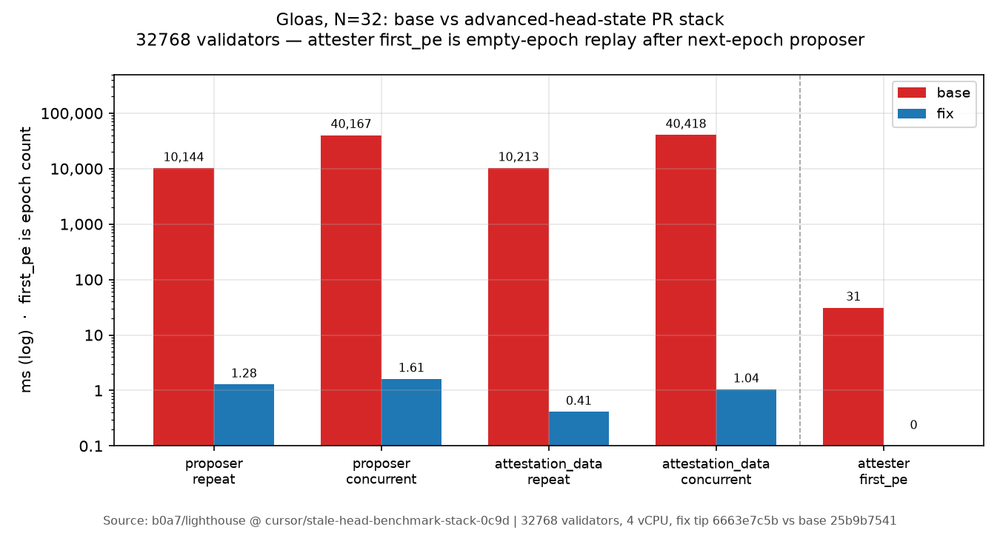
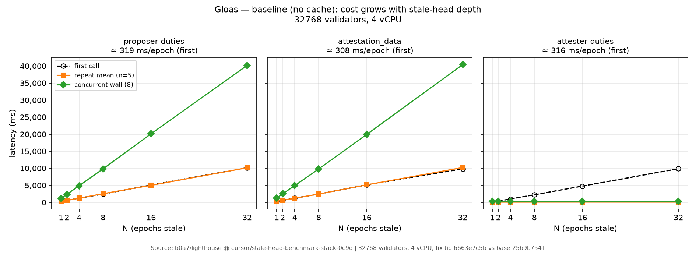
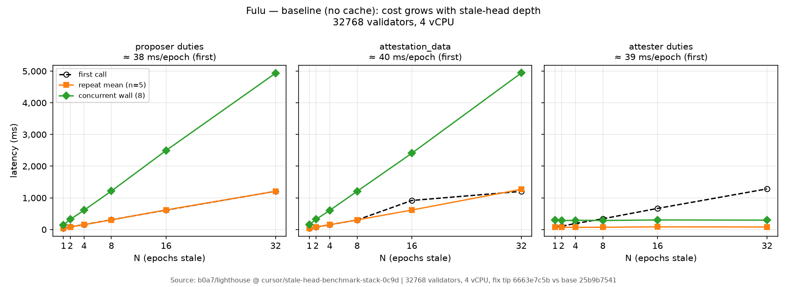
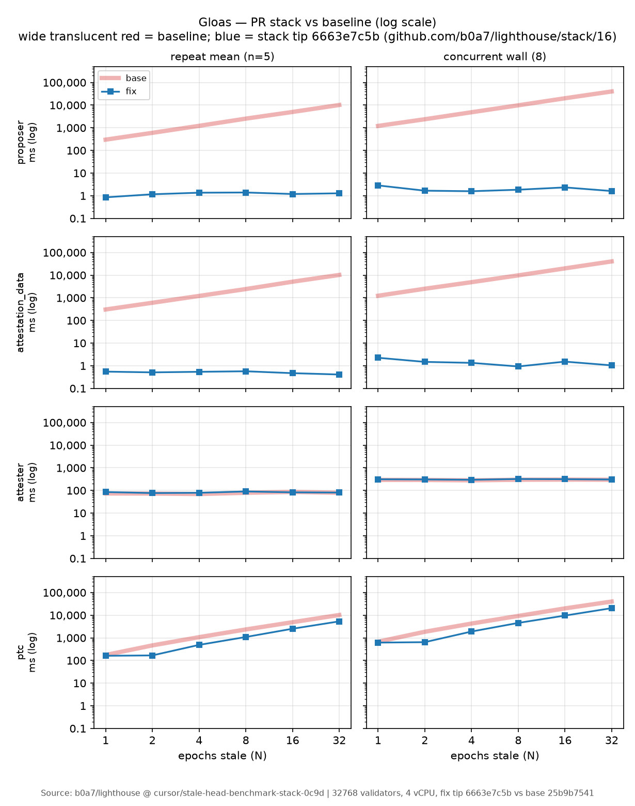
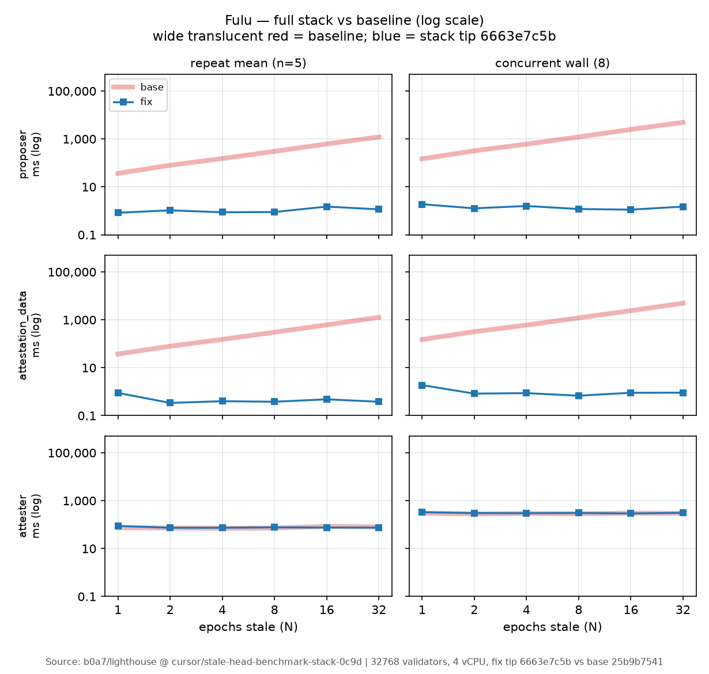
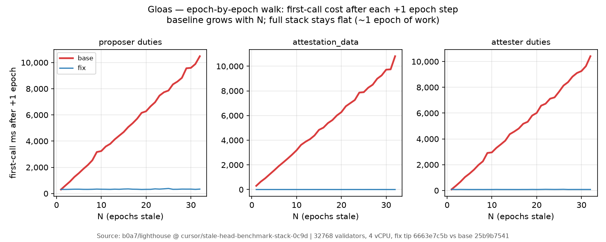

# Stale-head full-stack benchmark (#9530)

Evidence-only results for [sigp/lighthouse#9530](https://github.com/sigp/lighthouse/issues/9530).
**Not intended to be merged.**

| Branch | Tip | Role |
|---|---|---|
| `cursor/stale-head-benchmark-stack-0c9d` | advanced-head-state [PR stack](https://github.com/b0a7/lighthouse/stack/16) tip `6663e7c5b` + harness | fix |
| `cursor/stale-head-benchmark-stack-base-0c9d` | `25b9b7541` + harness | baseline |

This compares unstable to the completed [advanced-head-state PR stack](https://github.com/b0a7/lighthouse/stack/16) (layers 1–9 ending at `cursor/stale-head-stack-9-attester-priming-0c9d`).
32768 validators, 4 vCPU, Fulu + Gloas. Graphs regenerated by `benchmark-graphs/plot_bench.py`.

## Key takeaways

1. **Without a cache, validator API cost grows linearly with how stale the head is.** On Gloas at N=32, a warm repeat of proposer duties or attestation_data is about **10 s**; 8 concurrent calls take about **40 s** wall-clock.
2. **With the [advanced-head-state PR stack](https://github.com/b0a7/lighthouse/stack/16), those paths stay flat.** The same Gloas N=32 repeats drop to about **1 ms** (proposer) and **0.4 ms** (attestation_data). Concurrent wall stays about **1–2 ms**.
3. **Attester-after-proposer no longer replays empty epochs.** After a next-epoch proposer advance, current-epoch attester `first_pe` goes from **31 → 0** on both forks (shuffling priming).
4. **An epoch-by-epoch walk stays ~one epoch of work per step on the fix.** Baseline first-call cost keeps climbing with N; the [PR stack](https://github.com/b0a7/lighthouse/stack/16) stays flat.
5. **PTC on jump-to-N is only a partial win.** Cold jump first/repeat still scale with N on the fix; once the cache is warm from an incremental walk, PTC is flat (~160 ms, `first_pe=0` at N=32). Do not read the jump table as a full PTC fix.
6. **Block production pays a cold complete advance once, then reuses.** First call at N=32 is still seconds; repeats stay ~270 ms with `repeat_pe=0`. `states/{slot}/validators` was already cheap and stays cheap.

## Graphs



**Gloas, N=32 (worst case), log scale.** Baseline repeat/concurrent cost is tens of seconds. The [PR stack](https://github.com/b0a7/lighthouse/stack/16) brings proposer and attestation_data down to ~1 ms, and attester empty-epoch replay (`first_pe`) from 31 to 0.



**Gloas baseline:** first, repeat, and concurrent cost all grow with N (~300 ms per stale epoch on first call for these paths).



**Fulu baseline:** same linear shape, roughly 8× cheaper than Gloas (~37 ms per stale epoch on first call).



**Gloas, [PR stack](https://github.com/b0a7/lighthouse/stack/16) vs baseline (log).** Proposer and attestation_data repeats/concurrent stay flat near 1 ms with the stack applied. Attester *repeat* was already cheap on baseline once duties are cached; the stack win for attester is the first-call / `first_pe` path (see headline). PTC jump still slopes up — called out in takeaway 5.



**Fulu, [PR stack](https://github.com/b0a7/lighthouse/stack/16) vs baseline (log).** Same pattern as Gloas at lower absolute cost.



**Gloas epoch-by-epoch walk.** After each +1 epoch clock step, baseline first-call cost grows with N; the [PR stack](https://github.com/b0a7/lighthouse/stack/16) stays flat at roughly one epoch of work.

## Environment

| Item | Value |
|---|---|
| Fix tip | `6663e7c5b` ([PR stack](https://github.com/b0a7/lighthouse/stack/16) layer 9) |
| Baseline tip | `25b9b7541` |
| CPU | 4× (`available_parallelism=4`) |
| Memory | ~15 GiB |
| Rust | `rustc 1.91.0` |
| Validators | **32768** |
| Forks | Fulu and Gloas |
| Call order per N | next-epoch proposer → attestation_data → current-epoch attester → (PTC on Gloas) → block production → states/validators |
| Repeat / concurrent | 5 sequential repeats; 8 parallel identical calls |
| `first_pe` | delta of `beacon_state_processing_process_epoch` samples |

Timings are single-run wall-clock. Raw logs: `benchmark-results/{stack,base}-{jump,incr}.log`.

## Reproduce

```bash
# Fix
git fetch origin cursor/stale-head-benchmark-stack-0c9d && git checkout cursor/stale-head-benchmark-stack-0c9d
RUST_LOG=error STALE_HEAD_BENCH_VALIDATORS=32768 STALE_HEAD_BENCH_VARIANT=stack-6663e7c5b \
STALE_HEAD_BENCH_FORKS=fulu,gloas \
cargo test --release -p http_api --features beacon_chain/fork_from_env --test bn_http_api_tests \
  stale_head_http_api_benchmark -- --ignored --nocapture
# then stale_head_incremental_epoch_benchmark

# Baseline
git fetch origin cursor/stale-head-benchmark-stack-base-0c9d && git checkout cursor/stale-head-benchmark-stack-base-0c9d
# same commands with STALE_HEAD_BENCH_VARIANT=base-25b9b7541
```

Regenerate graphs after editing tables:

```bash
python3 benchmark-graphs/plot_bench.py
```

## Headline before/after (N=32)

Restart-onto-old-head sequence: first next-epoch proposer, then first current-epoch attester on the same stale head. Attester `first_pe` is the empty-epoch replay count after the proposer advance.

| Fork | Endpoint | Base first_ms | Base first_pe | Base repeat_mean_ms | Fix first_ms | Fix first_pe | Fix repeat_mean_ms |
|---|---|---:|---:|---:|---:|---:|---:|
| fulu | proposer_duties(next_epoch) | 1207.55 | 32 | 1206.73 | 627.57 | 16 | 1.15 |
| fulu | attestation_data(current_slot) | 1204.24 | 32 | 1270.12 | 0.73 | 0 | 0.38 |
| fulu | attester_duties(current_epoch) | 1282.90 | 31 | 80.48 | 79.45 | 0 | 75.07 |
| fulu | block_production(v3) | 1942.44 | 32 | 1927.22 | 1143.46 | 16 | 268.60 |
| gloas | proposer_duties(next_epoch) | 10164.13 | 32 | 10143.89 | 5338.10 | 16 | 1.28 |
| gloas | attestation_data(current_slot) | 9819.43 | 32 | 10213.15 | 1.08 | 0 | 0.41 |
| gloas | attester_duties(current_epoch) | 9867.31 | 31 | 78.99 | 96.13 | 0 | 80.65 |
| gloas | ptc_duties(current_epoch) | 10190.64 | 31 | 10202.29 | 5005.44 | 15 | 5332.69 |
| gloas | block_production(v4) | 10682.94 | 32 | 10999.13 | 6049.07 | 16 | 266.56 |

Attester-after-proposer `first_pe` at N=32: base 31 → fix **0** on both forks (shuffling priming).

Proposer / attestation_data / attester repeats stay flat on the fix. Block-production first call still pays a cold complete advance (~half the base, then retained); repeats stay ~270 ms with `repeat_pe=0`.

**PTC (Gloas) on jump-to-N still scales with N on both first and repeat** in this harness. The epoch-by-epoch walk below shows PTC flat once the cache is warm; the jump case is called out so it is not mistaken for a full PTC win.

## Epoch-by-epoch walk at N=32

| Fork | Endpoint | Base first_ms | Base first_pe | Fix first_ms | Fix first_pe |
|---|---|---:|---:|---:|---:|
| fulu | proposer_duties(next_epoch) | 1201.25 | 32 | 44.57 | 1 |
| fulu | attestation_data(current_slot) | 1194.14 | 32 | 0.86 | 0 |
| fulu | attester_duties(current_epoch) | 1316.36 | 31 | 77.61 | 0 |
| fulu | block_production(v3) | 1990.19 | 32 | 329.47 | 1 |
| gloas | proposer_duties(next_epoch) | 10481.62 | 32 | 335.29 | 1 |
| gloas | attestation_data(current_slot) | 10809.28 | 32 | 1.29 | 0 |
| gloas | attester_duties(current_epoch) | 10410.49 | 31 | 78.41 | 0 |
| gloas | ptc_duties(current_epoch) | 10072.57 | 31 | 160.27 | 0 |
| gloas | block_production(v4) | 11328.90 | 32 | 624.78 | 1 |

On the fix, the walk stays roughly one epoch of work per step. On the baseline it grows with N.

## Full tables

### Fix jump (`stack-6663e7c5b`)

### stale-head benchmark variant=`stack-6663e7c5b` validators=32768
| fork | endpoint | stale_epochs | first_ms | first_pe | repeat_mean_ms (n=5) | repeat_total_ms | repeat_pe_total | concurrent_wall_ms (n=8) | concurrent_cpu_ms | concurrent_pe |
|---|---|---:|---:|---:|---:|---:|---:|---:|---:|---:|
| fulu | proposer_duties(next_epoch) | 1 | 42.06 | 1 | 0.83 | 4.15 | 0 | 1.88 | 4.17 | 0 |
| fulu | attestation_data(current_slot) | 1 | 0.94 | 0 | 0.89 | 4.44 | 0 | 1.88 | 3.29 | 0 |
| fulu | attester_duties(current_epoch) | 1 | 83.12 | 0 | 88.03 | 440.16 | 0 | 329.91 | 638.33 | 0 |
| fulu | block_production(v3) | 1 | 321.78 | 1 | 261.21 | 1306.07 | 0 | 1041.55 | 76.12 | 0 |
| fulu | states/{slot}/validators(past_head) | 1 | 86.82 | 0 | 87.75 | 438.77 | 0 | 397.95 | 673.22 | 0 |
| fulu | proposer_duties(next_epoch) | 2 | 52.29 | 1 | 1.05 | 5.24 | 0 | 1.27 | 3.40 | 0 |
| fulu | attestation_data(current_slot) | 2 | 0.44 | 0 | 0.34 | 1.72 | 0 | 0.83 | 2.14 | 0 |
| fulu | attester_duties(current_epoch) | 2 | 75.04 | 0 | 74.14 | 370.70 | 0 | 304.18 | 616.33 | 0 |
| fulu | block_production(v3) | 2 | 328.89 | 1 | 261.92 | 1309.62 | 0 | 1039.12 | 71.61 | 0 |
| fulu | states/{slot}/validators(past_head) | 2 | 83.09 | 0 | 85.37 | 426.83 | 0 | 370.51 | 646.63 | 0 |
| fulu | proposer_duties(next_epoch) | 4 | 84.06 | 2 | 0.87 | 4.34 | 0 | 1.59 | 3.09 | 0 |
| fulu | attestation_data(current_slot) | 4 | 0.44 | 0 | 0.40 | 2.00 | 0 | 0.87 | 2.30 | 0 |
| fulu | attester_duties(current_epoch) | 4 | 75.00 | 0 | 74.30 | 371.51 | 0 | 299.83 | 612.19 | 0 |
| fulu | block_production(v3) | 4 | 372.82 | 2 | 260.19 | 1300.94 | 0 | 1037.10 | 71.35 | 0 |
| fulu | states/{slot}/validators(past_head) | 4 | 94.57 | 0 | 82.60 | 413.02 | 0 | 392.85 | 688.49 | 0 |
| fulu | proposer_duties(next_epoch) | 8 | 165.27 | 4 | 0.89 | 4.47 | 0 | 1.19 | 2.98 | 0 |
| fulu | attestation_data(current_slot) | 8 | 0.46 | 0 | 0.38 | 1.90 | 0 | 0.68 | 2.08 | 0 |
| fulu | attester_duties(current_epoch) | 8 | 75.09 | 0 | 77.12 | 385.61 | 0 | 306.57 | 621.41 | 0 |
| fulu | block_production(v3) | 8 | 488.74 | 4 | 261.45 | 1307.26 | 0 | 1039.62 | 74.52 | 0 |
| fulu | states/{slot}/validators(past_head) | 8 | 90.11 | 0 | 80.32 | 401.60 | 0 | 384.76 | 673.44 | 0 |
| fulu | proposer_duties(next_epoch) | 16 | 321.45 | 8 | 1.50 | 7.52 | 0 | 1.12 | 3.24 | 0 |
| fulu | attestation_data(current_slot) | 16 | 0.97 | 0 | 0.48 | 2.42 | 0 | 0.90 | 2.37 | 0 |
| fulu | attester_duties(current_epoch) | 16 | 83.48 | 0 | 75.32 | 376.62 | 0 | 292.93 | 594.38 | 0 |
| fulu | block_production(v3) | 16 | 704.91 | 8 | 266.17 | 1330.86 | 0 | 1056.27 | 116.26 | 0 |
| fulu | states/{slot}/validators(past_head) | 16 | 87.17 | 0 | 79.83 | 399.16 | 0 | 387.03 | 678.09 | 0 |
| fulu | proposer_duties(next_epoch) | 32 | 627.57 | 16 | 1.15 | 5.73 | 0 | 1.50 | 3.50 | 0 |
| fulu | attestation_data(current_slot) | 32 | 0.73 | 0 | 0.38 | 1.89 | 0 | 0.91 | 2.04 | 0 |
| fulu | attester_duties(current_epoch) | 32 | 79.45 | 0 | 75.07 | 375.37 | 0 | 311.36 | 637.69 | 0 |
| fulu | block_production(v3) | 32 | 1143.46 | 16 | 268.60 | 1343.01 | 0 | 1064.51 | 135.81 | 0 |
| fulu | states/{slot}/validators(past_head) | 32 | 89.72 | 0 | 79.44 | 397.19 | 0 | 386.83 | 695.95 | 0 |
| gloas | proposer_duties(next_epoch) | 1 | 313.66 | 1 | 0.85 | 4.24 | 0 | 2.85 | 5.26 | 0 |
| gloas | attestation_data(current_slot) | 1 | 0.78 | 0 | 0.55 | 2.75 | 0 | 2.25 | 4.09 | 0 |
| gloas | attester_duties(current_epoch) | 1 | 95.48 | 0 | 85.32 | 426.58 | 0 | 312.03 | 619.16 | 0 |
| gloas | ptc_duties(current_epoch) | 1 | 170.75 | 0 | 161.30 | 806.50 | 0 | 616.49 | 1295.40 | 0 |
| gloas | block_production(v4) | 1 | 636.25 | 1 | 264.97 | 1324.85 | 0 | 1049.24 | 96.13 | 0 |
| gloas | states/{slot}/validators(past_head) | 1 | 95.32 | 0 | 90.32 | 451.59 | 0 | 448.30 | 758.51 | 0 |
| gloas | proposer_duties(next_epoch) | 2 | 377.12 | 1 | 1.16 | 5.81 | 0 | 1.67 | 3.71 | 0 |
| gloas | attestation_data(current_slot) | 2 | 0.62 | 0 | 0.51 | 2.55 | 0 | 1.48 | 3.32 | 0 |
| gloas | attester_duties(current_epoch) | 2 | 76.45 | 0 | 76.88 | 384.39 | 0 | 306.25 | 621.13 | 0 |
| gloas | ptc_duties(current_epoch) | 2 | 161.57 | 0 | 167.37 | 836.86 | 0 | 642.98 | 1335.42 | 0 |
| gloas | block_production(v4) | 2 | 597.52 | 1 | 264.72 | 1323.60 | 0 | 1046.27 | 84.41 | 0 |
| gloas | states/{slot}/validators(past_head) | 2 | 86.53 | 0 | 85.42 | 427.10 | 0 | 399.61 | 687.34 | 0 |
| gloas | proposer_duties(next_epoch) | 4 | 647.79 | 2 | 1.36 | 6.81 | 0 | 1.58 | 4.35 | 0 |
| gloas | attestation_data(current_slot) | 4 | 0.51 | 0 | 0.54 | 2.71 | 0 | 1.34 | 3.05 | 0 |
| gloas | attester_duties(current_epoch) | 4 | 76.33 | 0 | 78.97 | 394.87 | 0 | 296.56 | 604.61 | 0 |
| gloas | ptc_duties(current_epoch) | 4 | 493.91 | 1 | 487.75 | 2438.76 | 5 | 1896.99 | 2556.18 | 4 |
| gloas | block_production(v4) | 4 | 944.55 | 2 | 264.82 | 1324.12 | 0 | 1047.51 | 93.95 | 0 |
| gloas | states/{slot}/validators(past_head) | 4 | 115.89 | 0 | 88.13 | 440.64 | 0 | 382.71 | 679.07 | 0 |
| gloas | proposer_duties(next_epoch) | 8 | 1342.82 | 4 | 1.39 | 6.94 | 0 | 1.84 | 4.47 | 0 |
| gloas | attestation_data(current_slot) | 8 | 1.16 | 0 | 0.57 | 2.83 | 0 | 0.93 | 2.75 | 0 |
| gloas | attester_duties(current_epoch) | 8 | 76.41 | 0 | 90.40 | 452.00 | 0 | 320.87 | 654.64 | 0 |
| gloas | ptc_duties(current_epoch) | 8 | 1127.98 | 3 | 1087.94 | 5439.69 | 15 | 4553.37 | 5226.98 | 12 |
| gloas | block_production(v4) | 8 | 1604.64 | 4 | 261.93 | 1309.67 | 0 | 1042.71 | 80.57 | 0 |
| gloas | states/{slot}/validators(past_head) | 8 | 113.50 | 0 | 89.14 | 445.69 | 0 | 404.43 | 715.03 | 0 |
| gloas | proposer_duties(next_epoch) | 16 | 2679.42 | 8 | 1.19 | 5.93 | 0 | 2.33 | 4.80 | 0 |
| gloas | attestation_data(current_slot) | 16 | 0.54 | 0 | 0.47 | 2.36 | 0 | 1.52 | 3.42 | 0 |
| gloas | attester_duties(current_epoch) | 16 | 79.48 | 0 | 82.69 | 413.44 | 0 | 315.14 | 659.29 | 0 |
| gloas | ptc_duties(current_epoch) | 16 | 2509.28 | 7 | 2520.36 | 12601.78 | 35 | 9599.57 | 10253.69 | 28 |
| gloas | block_production(v4) | 16 | 2991.03 | 8 | 265.32 | 1326.58 | 0 | 1056.20 | 105.03 | 0 |
| gloas | states/{slot}/validators(past_head) | 16 | 116.43 | 0 | 102.79 | 513.93 | 0 | 434.53 | 777.22 | 0 |
| gloas | proposer_duties(next_epoch) | 32 | 5338.10 | 16 | 1.28 | 6.39 | 0 | 1.61 | 3.62 | 0 |
| gloas | attestation_data(current_slot) | 32 | 1.08 | 0 | 0.41 | 2.04 | 0 | 1.04 | 2.79 | 0 |
| gloas | attester_duties(current_epoch) | 32 | 96.13 | 0 | 80.65 | 403.24 | 0 | 305.18 | 654.56 | 0 |
| gloas | ptc_duties(current_epoch) | 32 | 5005.44 | 15 | 5332.69 | 26663.45 | 75 | 20449.28 | 21115.62 | 60 |
| gloas | block_production(v4) | 32 | 6049.07 | 16 | 266.56 | 1332.78 | 0 | 1061.45 | 111.83 | 0 |
| gloas | states/{slot}/validators(past_head) | 32 | 121.62 | 0 | 91.88 | 459.42 | 0 | 414.48 | 769.12 | 0 |

### Baseline jump (`base-25b9b7541`)

### stale-head benchmark variant=`base-25b9b7541` validators=32768
| fork | endpoint | stale_epochs | first_ms | first_pe | repeat_mean_ms (n=5) | repeat_total_ms | repeat_pe_total | concurrent_wall_ms (n=8) | concurrent_cpu_ms | concurrent_pe |
|---|---|---:|---:|---:|---:|---:|---:|---:|---:|---:|
| fulu | proposer_duties(next_epoch) | 1 | 39.99 | 1 | 36.52 | 182.58 | 5 | 148.18 | 294.56 | 8 |
| fulu | attestation_data(current_slot) | 1 | 40.07 | 1 | 37.29 | 186.43 | 5 | 149.79 | 291.27 | 8 |
| fulu | attester_duties(current_epoch) | 1 | 91.18 | 0 | 74.74 | 373.69 | 0 | 299.15 | 595.35 | 0 |
| fulu | block_production(v3) | 1 | 322.82 | 1 | 315.17 | 1575.87 | 5 | 1261.81 | 523.76 | 8 |
| fulu | states/{slot}/validators(past_head) | 1 | 109.16 | 0 | 78.24 | 391.21 | 0 | 372.95 | 650.02 | 0 |
| fulu | proposer_duties(next_epoch) | 2 | 86.33 | 2 | 79.84 | 399.20 | 10 | 320.79 | 639.32 | 16 |
| fulu | attestation_data(current_slot) | 2 | 79.12 | 2 | 79.15 | 395.74 | 10 | 320.01 | 636.46 | 16 |
| fulu | attester_duties(current_epoch) | 2 | 106.84 | 1 | 71.94 | 359.71 | 0 | 280.40 | 571.68 | 0 |
| fulu | block_production(v3) | 2 | 386.33 | 2 | 370.50 | 1852.48 | 10 | 1479.97 | 992.99 | 16 |
| fulu | states/{slot}/validators(past_head) | 2 | 74.11 | 0 | 70.60 | 352.98 | 0 | 386.62 | 668.87 | 0 |
| fulu | proposer_duties(next_epoch) | 4 | 155.77 | 4 | 152.63 | 763.16 | 20 | 608.61 | 1211.78 | 32 |
| fulu | attestation_data(current_slot) | 4 | 151.93 | 4 | 152.11 | 760.55 | 20 | 603.63 | 1202.90 | 32 |
| fulu | attester_duties(current_epoch) | 4 | 189.13 | 3 | 70.67 | 353.34 | 0 | 292.75 | 583.88 | 0 |
| fulu | block_production(v3) | 4 | 474.20 | 4 | 473.28 | 2366.40 | 20 | 1894.16 | 1885.83 | 32 |
| fulu | states/{slot}/validators(past_head) | 4 | 73.19 | 0 | 70.72 | 353.61 | 0 | 351.16 | 622.50 | 0 |
| fulu | proposer_duties(next_epoch) | 8 | 307.97 | 8 | 304.01 | 1520.06 | 40 | 1213.41 | 2426.76 | 64 |
| fulu | attestation_data(current_slot) | 8 | 301.37 | 8 | 302.99 | 1514.95 | 40 | 1206.42 | 2410.81 | 64 |
| fulu | attester_duties(current_epoch) | 8 | 339.71 | 7 | 71.54 | 357.70 | 0 | 285.07 | 574.58 | 0 |
| fulu | block_production(v3) | 8 | 682.68 | 8 | 676.00 | 3380.00 | 40 | 2753.39 | 3673.13 | 64 |
| fulu | states/{slot}/validators(past_head) | 8 | 84.46 | 0 | 70.02 | 350.08 | 0 | 371.13 | 656.80 | 0 |
| fulu | proposer_duties(next_epoch) | 16 | 613.65 | 16 | 619.49 | 3097.45 | 80 | 2495.49 | 4982.98 | 128 |
| fulu | attestation_data(current_slot) | 16 | 917.49 | 16 | 614.84 | 3074.19 | 80 | 2407.88 | 4813.75 | 128 |
| fulu | attester_duties(current_epoch) | 16 | 666.79 | 15 | 84.78 | 423.90 | 0 | 302.43 | 607.57 | 0 |
| fulu | block_production(v3) | 16 | 1118.15 | 16 | 1136.98 | 5684.88 | 80 | 4442.42 | 7376.37 | 128 |
| fulu | states/{slot}/validators(past_head) | 16 | 95.25 | 0 | 75.33 | 376.67 | 0 | 373.92 | 652.52 | 0 |
| fulu | proposer_duties(next_epoch) | 32 | 1207.55 | 32 | 1206.73 | 6033.65 | 160 | 4934.83 | 9853.17 | 256 |
| fulu | attestation_data(current_slot) | 32 | 1204.24 | 32 | 1270.12 | 6350.58 | 160 | 4941.17 | 9863.03 | 256 |
| fulu | attester_duties(current_epoch) | 32 | 1282.90 | 31 | 80.48 | 402.42 | 0 | 296.36 | 590.71 | 0 |
| fulu | block_production(v3) | 32 | 1942.44 | 32 | 1927.22 | 9636.10 | 160 | 8166.08 | 15147.86 | 256 |
| fulu | states/{slot}/validators(past_head) | 32 | 83.27 | 0 | 75.55 | 377.75 | 0 | 394.23 | 696.87 | 0 |
| gloas | proposer_duties(next_epoch) | 1 | 302.01 | 1 | 299.02 | 1495.10 | 5 | 1208.23 | 2418.26 | 8 |
| gloas | attestation_data(current_slot) | 1 | 302.86 | 1 | 304.35 | 1521.73 | 5 | 1231.14 | 2417.14 | 8 |
| gloas | attester_duties(current_epoch) | 1 | 87.68 | 0 | 73.73 | 368.66 | 0 | 293.38 | 580.73 | 0 |
| gloas | ptc_duties(current_epoch) | 1 | 165.57 | 0 | 174.50 | 872.50 | 0 | 671.87 | 1361.79 | 0 |
| gloas | block_production(v4) | 1 | 579.98 | 1 | 571.64 | 2858.18 | 5 | 2351.60 | 2683.54 | 8 |
| gloas | states/{slot}/validators(past_head) | 1 | 82.47 | 0 | 77.15 | 385.76 | 0 | 375.05 | 651.84 | 0 |
| gloas | proposer_duties(next_epoch) | 2 | 594.48 | 2 | 597.62 | 2988.08 | 10 | 2380.29 | 4739.44 | 16 |
| gloas | attestation_data(current_slot) | 2 | 636.49 | 2 | 603.40 | 3017.02 | 10 | 2509.57 | 4897.53 | 16 |
| gloas | attester_duties(current_epoch) | 2 | 381.99 | 1 | 73.05 | 365.25 | 0 | 291.65 | 590.06 | 0 |
| gloas | ptc_duties(current_epoch) | 2 | 467.48 | 1 | 463.04 | 2315.20 | 5 | 1847.31 | 3741.47 | 8 |
| gloas | block_production(v4) | 2 | 908.67 | 2 | 917.73 | 4588.67 | 10 | 3672.06 | 5393.32 | 16 |
| gloas | states/{slot}/validators(past_head) | 2 | 133.20 | 0 | 81.61 | 408.07 | 0 | 394.16 | 766.47 | 0 |
| gloas | proposer_duties(next_epoch) | 4 | 1231.58 | 4 | 1218.49 | 6092.44 | 20 | 4854.15 | 9697.26 | 32 |
| gloas | attestation_data(current_slot) | 4 | 1222.83 | 4 | 1209.95 | 6049.75 | 20 | 4895.42 | 9740.27 | 32 |
| gloas | attester_duties(current_epoch) | 4 | 973.51 | 3 | 69.54 | 347.68 | 0 | 280.80 | 564.58 | 0 |
| gloas | ptc_duties(current_epoch) | 4 | 1077.14 | 3 | 1069.48 | 5347.42 | 15 | 4267.56 | 8584.71 | 24 |
| gloas | block_production(v4) | 4 | 1551.50 | 4 | 1573.83 | 7869.15 | 20 | 6267.71 | 10578.86 | 32 |
| gloas | states/{slot}/validators(past_head) | 4 | 115.76 | 0 | 77.44 | 387.19 | 0 | 363.43 | 665.36 | 0 |
| gloas | proposer_duties(next_epoch) | 8 | 2420.09 | 8 | 2534.01 | 12670.07 | 40 | 9817.93 | 19607.89 | 64 |
| gloas | attestation_data(current_slot) | 8 | 2435.38 | 8 | 2430.51 | 12152.56 | 40 | 9780.20 | 19472.03 | 64 |
| gloas | attester_duties(current_epoch) | 8 | 2228.05 | 7 | 78.99 | 394.96 | 0 | 296.97 | 604.49 | 0 |
| gloas | ptc_duties(current_epoch) | 8 | 2278.46 | 7 | 2342.33 | 11711.63 | 35 | 9257.44 | 18569.68 | 56 |
| gloas | block_production(v4) | 8 | 2908.83 | 8 | 2899.56 | 14497.79 | 40 | 11641.24 | 21470.28 | 64 |
| gloas | states/{slot}/validators(past_head) | 8 | 110.58 | 0 | 77.25 | 386.27 | 0 | 415.18 | 746.87 | 0 |
| gloas | proposer_duties(next_epoch) | 16 | 5083.10 | 16 | 5001.96 | 25009.79 | 80 | 20111.57 | 39584.14 | 128 |
| gloas | attestation_data(current_slot) | 16 | 5130.11 | 16 | 5133.66 | 25668.28 | 80 | 19927.78 | 39586.35 | 128 |
| gloas | attester_duties(current_epoch) | 16 | 4766.38 | 15 | 86.41 | 432.03 | 0 | 301.46 | 602.67 | 0 |
| gloas | ptc_duties(current_epoch) | 16 | 5086.39 | 15 | 4893.23 | 24466.17 | 75 | 19924.08 | 39715.58 | 120 |
| gloas | block_production(v4) | 16 | 5544.49 | 16 | 5456.40 | 27281.99 | 80 | 22039.37 | 42643.15 | 128 |
| gloas | states/{slot}/validators(past_head) | 16 | 110.32 | 0 | 76.80 | 384.01 | 0 | 392.97 | 742.56 | 0 |
| gloas | proposer_duties(next_epoch) | 32 | 10164.13 | 32 | 10143.89 | 50719.43 | 160 | 40167.34 | 79851.19 | 256 |
| gloas | attestation_data(current_slot) | 32 | 9819.43 | 32 | 10213.15 | 51065.76 | 160 | 40417.79 | 80033.96 | 256 |
| gloas | attester_duties(current_epoch) | 32 | 9867.31 | 31 | 78.99 | 394.96 | 0 | 297.38 | 615.01 | 0 |
| gloas | ptc_duties(current_epoch) | 32 | 10190.64 | 31 | 10202.29 | 51011.46 | 155 | 40032.64 | 79255.36 | 248 |
| gloas | block_production(v4) | 32 | 10682.94 | 32 | 10999.13 | 54995.66 | 160 | 42777.60 | 84668.14 | 256 |
| gloas | states/{slot}/validators(past_head) | 32 | 129.05 | 0 | 87.14 | 435.70 | 0 | 380.91 | 698.22 | 0 |

### Fix incremental (`stack-6663e7c5b`)

### stale-head epoch-by-epoch incremental variant=`stack-6663e7c5b` validators=32768
| fork | endpoint | stale_epochs | first_ms | first_pe |
|---|---|---:|---:|---:|
| fulu | proposer_duties(next_epoch) | 1 | 42.31 | 1 |
| fulu | attestation_data(current_slot) | 1 | 1.76 | 0 |
| fulu | attester_duties(current_epoch) | 1 | 82.25 | 0 |
| fulu | block_production(v3) | 1 | 321.81 | 1 |
| fulu | states/{slot}/validators(past_head) | 1 | 91.06 | 0 |
| fulu | proposer_duties(next_epoch) | 2 | 51.25 | 1 |
| fulu | attestation_data(current_slot) | 2 | 1.62 | 0 |
| fulu | attester_duties(current_epoch) | 2 | 81.22 | 0 |
| fulu | block_production(v3) | 2 | 331.68 | 1 |
| fulu | states/{slot}/validators(past_head) | 2 | 89.33 | 0 |
| fulu | proposer_duties(next_epoch) | 3 | 44.46 | 1 |
| fulu | attestation_data(current_slot) | 3 | 1.20 | 0 |
| fulu | attester_duties(current_epoch) | 3 | 79.10 | 0 |
| fulu | block_production(v3) | 3 | 321.49 | 1 |
| fulu | states/{slot}/validators(past_head) | 3 | 81.65 | 0 |
| fulu | proposer_duties(next_epoch) | 4 | 41.46 | 1 |
| fulu | attestation_data(current_slot) | 4 | 0.90 | 0 |
| fulu | attester_duties(current_epoch) | 4 | 75.03 | 0 |
| fulu | block_production(v3) | 4 | 322.33 | 1 |
| fulu | states/{slot}/validators(past_head) | 4 | 81.21 | 0 |
| fulu | proposer_duties(next_epoch) | 5 | 41.46 | 1 |
| fulu | attestation_data(current_slot) | 5 | 0.82 | 0 |
| fulu | attester_duties(current_epoch) | 5 | 77.02 | 0 |
| fulu | block_production(v3) | 5 | 324.31 | 1 |
| fulu | states/{slot}/validators(past_head) | 5 | 81.75 | 0 |
| fulu | proposer_duties(next_epoch) | 6 | 48.22 | 1 |
| fulu | attestation_data(current_slot) | 6 | 0.72 | 0 |
| fulu | attester_duties(current_epoch) | 6 | 76.53 | 0 |
| fulu | block_production(v3) | 6 | 333.13 | 1 |
| fulu | states/{slot}/validators(past_head) | 6 | 78.60 | 0 |
| fulu | proposer_duties(next_epoch) | 7 | 54.82 | 1 |
| fulu | attestation_data(current_slot) | 7 | 0.92 | 0 |
| fulu | attester_duties(current_epoch) | 7 | 75.03 | 0 |
| fulu | block_production(v3) | 7 | 334.75 | 1 |
| fulu | states/{slot}/validators(past_head) | 7 | 78.33 | 0 |
| fulu | proposer_duties(next_epoch) | 8 | 39.23 | 1 |
| fulu | attestation_data(current_slot) | 8 | 1.06 | 0 |
| fulu | attester_duties(current_epoch) | 8 | 75.99 | 0 |
| fulu | block_production(v3) | 8 | 325.73 | 1 |
| fulu | states/{slot}/validators(past_head) | 8 | 77.25 | 0 |
| fulu | proposer_duties(next_epoch) | 9 | 43.17 | 1 |
| fulu | attestation_data(current_slot) | 9 | 0.72 | 0 |
| fulu | attester_duties(current_epoch) | 9 | 74.97 | 0 |
| fulu | block_production(v3) | 9 | 330.17 | 1 |
| fulu | states/{slot}/validators(past_head) | 9 | 84.53 | 0 |
| fulu | proposer_duties(next_epoch) | 10 | 46.49 | 1 |
| fulu | attestation_data(current_slot) | 10 | 0.83 | 0 |
| fulu | attester_duties(current_epoch) | 10 | 76.13 | 0 |
| fulu | block_production(v3) | 10 | 321.71 | 1 |
| fulu | states/{slot}/validators(past_head) | 10 | 78.15 | 0 |
| fulu | proposer_duties(next_epoch) | 11 | 44.93 | 1 |
| fulu | attestation_data(current_slot) | 11 | 1.31 | 0 |
| fulu | attester_duties(current_epoch) | 11 | 75.51 | 0 |
| fulu | block_production(v3) | 11 | 323.53 | 1 |
| fulu | states/{slot}/validators(past_head) | 11 | 77.10 | 0 |
| fulu | proposer_duties(next_epoch) | 12 | 47.50 | 1 |
| fulu | attestation_data(current_slot) | 12 | 0.95 | 0 |
| fulu | attester_duties(current_epoch) | 12 | 76.34 | 0 |
| fulu | block_production(v3) | 12 | 329.42 | 1 |
| fulu | states/{slot}/validators(past_head) | 12 | 82.99 | 0 |
| fulu | proposer_duties(next_epoch) | 13 | 46.40 | 1 |
| fulu | attestation_data(current_slot) | 13 | 1.01 | 0 |
| fulu | attester_duties(current_epoch) | 13 | 76.21 | 0 |
| fulu | block_production(v3) | 13 | 328.21 | 1 |
| fulu | states/{slot}/validators(past_head) | 13 | 85.78 | 0 |
| fulu | proposer_duties(next_epoch) | 14 | 61.07 | 1 |
| fulu | attestation_data(current_slot) | 14 | 0.85 | 0 |
| fulu | attester_duties(current_epoch) | 14 | 105.50 | 0 |
| fulu | block_production(v3) | 14 | 327.52 | 1 |
| fulu | states/{slot}/validators(past_head) | 14 | 115.12 | 0 |
| fulu | proposer_duties(next_epoch) | 15 | 44.19 | 1 |
| fulu | attestation_data(current_slot) | 15 | 0.99 | 0 |
| fulu | attester_duties(current_epoch) | 15 | 100.91 | 0 |
| fulu | block_production(v3) | 15 | 344.43 | 1 |
| fulu | states/{slot}/validators(past_head) | 15 | 110.13 | 0 |
| fulu | proposer_duties(next_epoch) | 16 | 48.86 | 1 |
| fulu | attestation_data(current_slot) | 16 | 1.54 | 0 |
| fulu | attester_duties(current_epoch) | 16 | 76.35 | 0 |
| fulu | block_production(v3) | 16 | 324.84 | 1 |
| fulu | states/{slot}/validators(past_head) | 16 | 77.95 | 0 |
| fulu | proposer_duties(next_epoch) | 17 | 56.90 | 1 |
| fulu | attestation_data(current_slot) | 17 | 0.86 | 0 |
| fulu | attester_duties(current_epoch) | 17 | 75.65 | 0 |
| fulu | block_production(v3) | 17 | 337.68 | 1 |
| fulu | states/{slot}/validators(past_head) | 17 | 77.88 | 0 |
| fulu | proposer_duties(next_epoch) | 18 | 37.58 | 1 |
| fulu | attestation_data(current_slot) | 18 | 0.76 | 0 |
| fulu | attester_duties(current_epoch) | 18 | 75.87 | 0 |
| fulu | block_production(v3) | 18 | 323.84 | 1 |
| fulu | states/{slot}/validators(past_head) | 18 | 78.47 | 0 |
| fulu | proposer_duties(next_epoch) | 19 | 43.16 | 1 |
| fulu | attestation_data(current_slot) | 19 | 1.20 | 0 |
| fulu | attester_duties(current_epoch) | 19 | 74.31 | 0 |
| fulu | block_production(v3) | 19 | 325.69 | 1 |
| fulu | states/{slot}/validators(past_head) | 19 | 75.65 | 0 |
| fulu | proposer_duties(next_epoch) | 20 | 40.01 | 1 |
| fulu | attestation_data(current_slot) | 20 | 1.11 | 0 |
| fulu | attester_duties(current_epoch) | 20 | 75.15 | 0 |
| fulu | block_production(v3) | 20 | 323.49 | 1 |
| fulu | states/{slot}/validators(past_head) | 20 | 78.97 | 0 |
| fulu | proposer_duties(next_epoch) | 21 | 36.61 | 1 |
| fulu | attestation_data(current_slot) | 21 | 0.81 | 0 |
| fulu | attester_duties(current_epoch) | 21 | 76.21 | 0 |
| fulu | block_production(v3) | 21 | 314.12 | 1 |
| fulu | states/{slot}/validators(past_head) | 21 | 77.29 | 0 |
| fulu | proposer_duties(next_epoch) | 22 | 39.59 | 1 |
| fulu | attestation_data(current_slot) | 22 | 0.93 | 0 |
| fulu | attester_duties(current_epoch) | 22 | 75.32 | 0 |
| fulu | block_production(v3) | 22 | 317.08 | 1 |
| fulu | states/{slot}/validators(past_head) | 22 | 77.95 | 0 |
| fulu | proposer_duties(next_epoch) | 23 | 34.02 | 1 |
| fulu | attestation_data(current_slot) | 23 | 1.10 | 0 |
| fulu | attester_duties(current_epoch) | 23 | 74.58 | 0 |
| fulu | block_production(v3) | 23 | 320.44 | 1 |
| fulu | states/{slot}/validators(past_head) | 23 | 77.64 | 0 |
| fulu | proposer_duties(next_epoch) | 24 | 46.49 | 1 |
| fulu | attestation_data(current_slot) | 24 | 1.09 | 0 |
| fulu | attester_duties(current_epoch) | 24 | 79.22 | 0 |
| fulu | block_production(v3) | 24 | 333.66 | 1 |
| fulu | states/{slot}/validators(past_head) | 24 | 77.23 | 0 |
| fulu | proposer_duties(next_epoch) | 25 | 40.58 | 1 |
| fulu | attestation_data(current_slot) | 25 | 1.04 | 0 |
| fulu | attester_duties(current_epoch) | 25 | 74.82 | 0 |
| fulu | block_production(v3) | 25 | 322.14 | 1 |
| fulu | states/{slot}/validators(past_head) | 25 | 80.09 | 0 |
| fulu | proposer_duties(next_epoch) | 26 | 50.73 | 1 |
| fulu | attestation_data(current_slot) | 26 | 1.31 | 0 |
| fulu | attester_duties(current_epoch) | 26 | 74.89 | 0 |
| fulu | block_production(v3) | 26 | 336.30 | 1 |
| fulu | states/{slot}/validators(past_head) | 26 | 78.02 | 0 |
| fulu | proposer_duties(next_epoch) | 27 | 47.24 | 1 |
| fulu | attestation_data(current_slot) | 27 | 0.77 | 0 |
| fulu | attester_duties(current_epoch) | 27 | 75.51 | 0 |
| fulu | block_production(v3) | 27 | 330.59 | 1 |
| fulu | states/{slot}/validators(past_head) | 27 | 85.13 | 0 |
| fulu | proposer_duties(next_epoch) | 28 | 53.61 | 1 |
| fulu | attestation_data(current_slot) | 28 | 0.96 | 0 |
| fulu | attester_duties(current_epoch) | 28 | 80.53 | 0 |
| fulu | block_production(v3) | 28 | 335.41 | 1 |
| fulu | states/{slot}/validators(past_head) | 28 | 104.33 | 0 |
| fulu | proposer_duties(next_epoch) | 29 | 60.83 | 1 |
| fulu | attestation_data(current_slot) | 29 | 1.08 | 0 |
| fulu | attester_duties(current_epoch) | 29 | 76.47 | 0 |
| fulu | block_production(v3) | 29 | 344.94 | 1 |
| fulu | states/{slot}/validators(past_head) | 29 | 90.44 | 0 |
| fulu | proposer_duties(next_epoch) | 30 | 61.94 | 1 |
| fulu | attestation_data(current_slot) | 30 | 0.85 | 0 |
| fulu | attester_duties(current_epoch) | 30 | 92.94 | 0 |
| fulu | block_production(v3) | 30 | 350.03 | 1 |
| fulu | states/{slot}/validators(past_head) | 30 | 80.14 | 0 |
| fulu | proposer_duties(next_epoch) | 31 | 45.00 | 1 |
| fulu | attestation_data(current_slot) | 31 | 1.30 | 0 |
| fulu | attester_duties(current_epoch) | 31 | 75.87 | 0 |
| fulu | block_production(v3) | 31 | 326.98 | 1 |
| fulu | states/{slot}/validators(past_head) | 31 | 78.86 | 0 |
| fulu | proposer_duties(next_epoch) | 32 | 44.57 | 1 |
| fulu | attestation_data(current_slot) | 32 | 0.86 | 0 |
| fulu | attester_duties(current_epoch) | 32 | 77.61 | 0 |
| fulu | block_production(v3) | 32 | 329.47 | 1 |
| fulu | states/{slot}/validators(past_head) | 32 | 83.54 | 0 |
| gloas | proposer_duties(next_epoch) | 1 | 309.90 | 1 |
| gloas | attestation_data(current_slot) | 1 | 1.40 | 0 |
| gloas | attester_duties(current_epoch) | 1 | 84.25 | 0 |
| gloas | ptc_duties(current_epoch) | 1 | 159.93 | 0 |
| gloas | block_production(v4) | 1 | 602.27 | 1 |
| gloas | states/{slot}/validators(past_head) | 1 | 96.81 | 0 |
| gloas | proposer_duties(next_epoch) | 2 | 311.46 | 1 |
| gloas | attestation_data(current_slot) | 2 | 1.11 | 0 |
| gloas | attester_duties(current_epoch) | 2 | 77.16 | 0 |
| gloas | ptc_duties(current_epoch) | 2 | 166.96 | 0 |
| gloas | block_production(v4) | 2 | 602.34 | 1 |
| gloas | states/{slot}/validators(past_head) | 2 | 89.21 | 0 |
| gloas | proposer_duties(next_epoch) | 3 | 319.14 | 1 |
| gloas | attestation_data(current_slot) | 3 | 0.71 | 0 |
| gloas | attester_duties(current_epoch) | 3 | 81.69 | 0 |
| gloas | ptc_duties(current_epoch) | 3 | 163.84 | 0 |
| gloas | block_production(v4) | 3 | 610.93 | 1 |
| gloas | states/{slot}/validators(past_head) | 3 | 91.00 | 0 |
| gloas | proposer_duties(next_epoch) | 4 | 327.41 | 1 |
| gloas | attestation_data(current_slot) | 4 | 1.03 | 0 |
| gloas | attester_duties(current_epoch) | 4 | 78.64 | 0 |
| gloas | ptc_duties(current_epoch) | 4 | 159.32 | 0 |
| gloas | block_production(v4) | 4 | 639.20 | 1 |
| gloas | states/{slot}/validators(past_head) | 4 | 84.57 | 0 |
| gloas | proposer_duties(next_epoch) | 5 | 327.87 | 1 |
| gloas | attestation_data(current_slot) | 5 | 1.06 | 0 |
| gloas | attester_duties(current_epoch) | 5 | 76.13 | 0 |
| gloas | ptc_duties(current_epoch) | 5 | 170.20 | 0 |
| gloas | block_production(v4) | 5 | 608.07 | 1 |
| gloas | states/{slot}/validators(past_head) | 5 | 95.44 | 0 |
| gloas | proposer_duties(next_epoch) | 6 | 315.61 | 1 |
| gloas | attestation_data(current_slot) | 6 | 0.76 | 0 |
| gloas | attester_duties(current_epoch) | 6 | 75.76 | 0 |
| gloas | ptc_duties(current_epoch) | 6 | 165.30 | 0 |
| gloas | block_production(v4) | 6 | 633.28 | 1 |
| gloas | states/{slot}/validators(past_head) | 6 | 85.42 | 0 |
| gloas | proposer_duties(next_epoch) | 7 | 314.15 | 1 |
| gloas | attestation_data(current_slot) | 7 | 1.59 | 0 |
| gloas | attester_duties(current_epoch) | 7 | 76.60 | 0 |
| gloas | ptc_duties(current_epoch) | 7 | 169.53 | 0 |
| gloas | block_production(v4) | 7 | 608.83 | 1 |
| gloas | states/{slot}/validators(past_head) | 7 | 85.68 | 0 |
| gloas | proposer_duties(next_epoch) | 8 | 321.65 | 1 |
| gloas | attestation_data(current_slot) | 8 | 0.99 | 0 |
| gloas | attester_duties(current_epoch) | 8 | 74.92 | 0 |
| gloas | ptc_duties(current_epoch) | 8 | 160.58 | 0 |
| gloas | block_production(v4) | 8 | 610.70 | 1 |
| gloas | states/{slot}/validators(past_head) | 8 | 84.01 | 0 |
| gloas | proposer_duties(next_epoch) | 9 | 335.29 | 1 |
| gloas | attestation_data(current_slot) | 9 | 1.14 | 0 |
| gloas | attester_duties(current_epoch) | 9 | 76.66 | 0 |
| gloas | ptc_duties(current_epoch) | 9 | 159.45 | 0 |
| gloas | block_production(v4) | 9 | 622.38 | 1 |
| gloas | states/{slot}/validators(past_head) | 9 | 83.52 | 0 |
| gloas | proposer_duties(next_epoch) | 10 | 325.56 | 1 |
| gloas | attestation_data(current_slot) | 10 | 1.04 | 0 |
| gloas | attester_duties(current_epoch) | 10 | 75.87 | 0 |
| gloas | ptc_duties(current_epoch) | 10 | 159.43 | 0 |
| gloas | block_production(v4) | 10 | 628.91 | 1 |
| gloas | states/{slot}/validators(past_head) | 10 | 85.07 | 0 |
| gloas | proposer_duties(next_epoch) | 11 | 322.05 | 1 |
| gloas | attestation_data(current_slot) | 11 | 0.88 | 0 |
| gloas | attester_duties(current_epoch) | 11 | 80.01 | 0 |
| gloas | ptc_duties(current_epoch) | 11 | 165.00 | 0 |
| gloas | block_production(v4) | 11 | 607.38 | 1 |
| gloas | states/{slot}/validators(past_head) | 11 | 87.28 | 0 |
| gloas | proposer_duties(next_epoch) | 12 | 314.69 | 1 |
| gloas | attestation_data(current_slot) | 12 | 1.21 | 0 |
| gloas | attester_duties(current_epoch) | 12 | 76.54 | 0 |
| gloas | ptc_duties(current_epoch) | 12 | 161.10 | 0 |
| gloas | block_production(v4) | 12 | 604.00 | 1 |
| gloas | states/{slot}/validators(past_head) | 12 | 84.43 | 0 |
| gloas | proposer_duties(next_epoch) | 13 | 329.88 | 1 |
| gloas | attestation_data(current_slot) | 13 | 0.95 | 0 |
| gloas | attester_duties(current_epoch) | 13 | 76.77 | 0 |
| gloas | ptc_duties(current_epoch) | 13 | 163.33 | 0 |
| gloas | block_production(v4) | 13 | 627.48 | 1 |
| gloas | states/{slot}/validators(past_head) | 13 | 86.47 | 0 |
| gloas | proposer_duties(next_epoch) | 14 | 321.09 | 1 |
| gloas | attestation_data(current_slot) | 14 | 1.13 | 0 |
| gloas | attester_duties(current_epoch) | 14 | 76.16 | 0 |
| gloas | ptc_duties(current_epoch) | 14 | 160.20 | 0 |
| gloas | block_production(v4) | 14 | 603.48 | 1 |
| gloas | states/{slot}/validators(past_head) | 14 | 86.53 | 0 |
| gloas | proposer_duties(next_epoch) | 15 | 340.07 | 1 |
| gloas | attestation_data(current_slot) | 15 | 1.10 | 0 |
| gloas | attester_duties(current_epoch) | 15 | 75.68 | 0 |
| gloas | ptc_duties(current_epoch) | 15 | 161.78 | 0 |
| gloas | block_production(v4) | 15 | 621.24 | 1 |
| gloas | states/{slot}/validators(past_head) | 15 | 85.13 | 0 |
| gloas | proposer_duties(next_epoch) | 16 | 348.58 | 1 |
| gloas | attestation_data(current_slot) | 16 | 1.18 | 0 |
| gloas | attester_duties(current_epoch) | 16 | 75.16 | 0 |
| gloas | ptc_duties(current_epoch) | 16 | 168.69 | 0 |
| gloas | block_production(v4) | 16 | 600.21 | 1 |
| gloas | states/{slot}/validators(past_head) | 16 | 89.03 | 0 |
| gloas | proposer_duties(next_epoch) | 17 | 327.63 | 1 |
| gloas | attestation_data(current_slot) | 17 | 1.05 | 0 |
| gloas | attester_duties(current_epoch) | 17 | 77.35 | 0 |
| gloas | ptc_duties(current_epoch) | 17 | 160.87 | 0 |
| gloas | block_production(v4) | 17 | 614.41 | 1 |
| gloas | states/{slot}/validators(past_head) | 17 | 89.80 | 0 |
| gloas | proposer_duties(next_epoch) | 18 | 323.04 | 1 |
| gloas | attestation_data(current_slot) | 18 | 0.89 | 0 |
| gloas | attester_duties(current_epoch) | 18 | 76.91 | 0 |
| gloas | ptc_duties(current_epoch) | 18 | 168.70 | 0 |
| gloas | block_production(v4) | 18 | 637.58 | 1 |
| gloas | states/{slot}/validators(past_head) | 18 | 87.98 | 0 |
| gloas | proposer_duties(next_epoch) | 19 | 308.41 | 1 |
| gloas | attestation_data(current_slot) | 19 | 0.85 | 0 |
| gloas | attester_duties(current_epoch) | 19 | 81.29 | 0 |
| gloas | ptc_duties(current_epoch) | 19 | 160.07 | 0 |
| gloas | block_production(v4) | 19 | 604.69 | 1 |
| gloas | states/{slot}/validators(past_head) | 19 | 87.94 | 0 |
| gloas | proposer_duties(next_epoch) | 20 | 316.25 | 1 |
| gloas | attestation_data(current_slot) | 20 | 0.71 | 0 |
| gloas | attester_duties(current_epoch) | 20 | 77.27 | 0 |
| gloas | ptc_duties(current_epoch) | 20 | 161.08 | 0 |
| gloas | block_production(v4) | 20 | 612.54 | 1 |
| gloas | states/{slot}/validators(past_head) | 20 | 86.77 | 0 |
| gloas | proposer_duties(next_epoch) | 21 | 317.50 | 1 |
| gloas | attestation_data(current_slot) | 21 | 0.98 | 0 |
| gloas | attester_duties(current_epoch) | 21 | 81.81 | 0 |
| gloas | ptc_duties(current_epoch) | 21 | 167.33 | 0 |
| gloas | block_production(v4) | 21 | 652.41 | 1 |
| gloas | states/{slot}/validators(past_head) | 21 | 95.23 | 0 |
| gloas | proposer_duties(next_epoch) | 22 | 352.03 | 1 |
| gloas | attestation_data(current_slot) | 22 | 1.24 | 0 |
| gloas | attester_duties(current_epoch) | 22 | 88.87 | 0 |
| gloas | ptc_duties(current_epoch) | 22 | 168.05 | 0 |
| gloas | block_production(v4) | 22 | 644.88 | 1 |
| gloas | states/{slot}/validators(past_head) | 22 | 95.21 | 0 |
| gloas | proposer_duties(next_epoch) | 23 | 335.06 | 1 |
| gloas | attestation_data(current_slot) | 23 | 1.38 | 0 |
| gloas | attester_duties(current_epoch) | 23 | 84.18 | 0 |
| gloas | ptc_duties(current_epoch) | 23 | 201.07 | 0 |
| gloas | block_production(v4) | 23 | 642.27 | 1 |
| gloas | states/{slot}/validators(past_head) | 23 | 93.15 | 0 |
| gloas | proposer_duties(next_epoch) | 24 | 355.84 | 1 |
| gloas | attestation_data(current_slot) | 24 | 1.19 | 0 |
| gloas | attester_duties(current_epoch) | 24 | 80.86 | 0 |
| gloas | ptc_duties(current_epoch) | 24 | 167.40 | 0 |
| gloas | block_production(v4) | 24 | 624.33 | 1 |
| gloas | states/{slot}/validators(past_head) | 24 | 112.58 | 0 |
| gloas | proposer_duties(next_epoch) | 25 | 383.37 | 1 |
| gloas | attestation_data(current_slot) | 25 | 0.84 | 0 |
| gloas | attester_duties(current_epoch) | 25 | 83.61 | 0 |
| gloas | ptc_duties(current_epoch) | 25 | 166.61 | 0 |
| gloas | block_production(v4) | 25 | 624.05 | 1 |
| gloas | states/{slot}/validators(past_head) | 25 | 86.81 | 0 |
| gloas | proposer_duties(next_epoch) | 26 | 318.47 | 1 |
| gloas | attestation_data(current_slot) | 26 | 1.64 | 0 |
| gloas | attester_duties(current_epoch) | 26 | 89.42 | 0 |
| gloas | ptc_duties(current_epoch) | 26 | 168.51 | 0 |
| gloas | block_production(v4) | 26 | 671.27 | 1 |
| gloas | states/{slot}/validators(past_head) | 26 | 84.67 | 0 |
| gloas | proposer_duties(next_epoch) | 27 | 321.66 | 1 |
| gloas | attestation_data(current_slot) | 27 | 0.90 | 0 |
| gloas | attester_duties(current_epoch) | 27 | 76.66 | 0 |
| gloas | ptc_duties(current_epoch) | 27 | 160.83 | 0 |
| gloas | block_production(v4) | 27 | 654.01 | 1 |
| gloas | states/{slot}/validators(past_head) | 27 | 88.19 | 0 |
| gloas | proposer_duties(next_epoch) | 28 | 335.82 | 1 |
| gloas | attestation_data(current_slot) | 28 | 1.00 | 0 |
| gloas | attester_duties(current_epoch) | 28 | 77.72 | 0 |
| gloas | ptc_duties(current_epoch) | 28 | 169.83 | 0 |
| gloas | block_production(v4) | 28 | 631.52 | 1 |
| gloas | states/{slot}/validators(past_head) | 28 | 89.40 | 0 |
| gloas | proposer_duties(next_epoch) | 29 | 333.70 | 1 |
| gloas | attestation_data(current_slot) | 29 | 1.79 | 0 |
| gloas | attester_duties(current_epoch) | 29 | 78.21 | 0 |
| gloas | ptc_duties(current_epoch) | 29 | 164.64 | 0 |
| gloas | block_production(v4) | 29 | 632.89 | 1 |
| gloas | states/{slot}/validators(past_head) | 29 | 102.00 | 0 |
| gloas | proposer_duties(next_epoch) | 30 | 334.39 | 1 |
| gloas | attestation_data(current_slot) | 30 | 1.21 | 0 |
| gloas | attester_duties(current_epoch) | 30 | 78.16 | 0 |
| gloas | ptc_duties(current_epoch) | 30 | 168.94 | 0 |
| gloas | block_production(v4) | 30 | 638.25 | 1 |
| gloas | states/{slot}/validators(past_head) | 30 | 88.22 | 0 |
| gloas | proposer_duties(next_epoch) | 31 | 315.02 | 1 |
| gloas | attestation_data(current_slot) | 31 | 0.92 | 0 |
| gloas | attester_duties(current_epoch) | 31 | 78.47 | 0 |
| gloas | ptc_duties(current_epoch) | 31 | 160.53 | 0 |
| gloas | block_production(v4) | 31 | 600.41 | 1 |
| gloas | states/{slot}/validators(past_head) | 31 | 82.11 | 0 |
| gloas | proposer_duties(next_epoch) | 32 | 335.29 | 1 |
| gloas | attestation_data(current_slot) | 32 | 1.29 | 0 |
| gloas | attester_duties(current_epoch) | 32 | 78.41 | 0 |
| gloas | ptc_duties(current_epoch) | 32 | 160.27 | 0 |
| gloas | block_production(v4) | 32 | 624.78 | 1 |
| gloas | states/{slot}/validators(past_head) | 32 | 83.14 | 0 |

### Baseline incremental (`base-25b9b7541`)

### stale-head epoch-by-epoch incremental variant=`base-25b9b7541` validators=32768
| fork | endpoint | stale_epochs | first_ms | first_pe |
|---|---|---:|---:|---:|
| fulu | proposer_duties(next_epoch) | 1 | 46.41 | 1 |
| fulu | attestation_data(current_slot) | 1 | 41.65 | 1 |
| fulu | attester_duties(current_epoch) | 1 | 80.13 | 0 |
| fulu | block_production(v3) | 1 | 322.56 | 1 |
| fulu | states/{slot}/validators(past_head) | 1 | 92.81 | 0 |
| fulu | proposer_duties(next_epoch) | 2 | 83.03 | 2 |
| fulu | attestation_data(current_slot) | 2 | 79.19 | 2 |
| fulu | attester_duties(current_epoch) | 2 | 123.87 | 1 |
| fulu | block_production(v3) | 2 | 367.14 | 2 |
| fulu | states/{slot}/validators(past_head) | 2 | 81.29 | 0 |
| fulu | proposer_duties(next_epoch) | 3 | 121.95 | 3 |
| fulu | attestation_data(current_slot) | 3 | 117.56 | 3 |
| fulu | attester_duties(current_epoch) | 3 | 164.71 | 2 |
| fulu | block_production(v3) | 3 | 416.75 | 3 |
| fulu | states/{slot}/validators(past_head) | 3 | 82.89 | 0 |
| fulu | proposer_duties(next_epoch) | 4 | 151.45 | 4 |
| fulu | attestation_data(current_slot) | 4 | 149.96 | 4 |
| fulu | attester_duties(current_epoch) | 4 | 185.22 | 3 |
| fulu | block_production(v3) | 4 | 464.41 | 4 |
| fulu | states/{slot}/validators(past_head) | 4 | 74.82 | 0 |
| fulu | proposer_duties(next_epoch) | 5 | 183.88 | 5 |
| fulu | attestation_data(current_slot) | 5 | 183.05 | 5 |
| fulu | attester_duties(current_epoch) | 5 | 222.75 | 4 |
| fulu | block_production(v3) | 5 | 520.88 | 5 |
| fulu | states/{slot}/validators(past_head) | 5 | 76.90 | 0 |
| fulu | proposer_duties(next_epoch) | 6 | 225.08 | 6 |
| fulu | attestation_data(current_slot) | 6 | 223.78 | 6 |
| fulu | attester_duties(current_epoch) | 6 | 262.23 | 5 |
| fulu | block_production(v3) | 6 | 590.31 | 6 |
| fulu | states/{slot}/validators(past_head) | 6 | 79.24 | 0 |
| fulu | proposer_duties(next_epoch) | 7 | 272.38 | 7 |
| fulu | attestation_data(current_slot) | 7 | 268.52 | 7 |
| fulu | attester_duties(current_epoch) | 7 | 294.79 | 6 |
| fulu | block_production(v3) | 7 | 639.32 | 7 |
| fulu | states/{slot}/validators(past_head) | 7 | 75.40 | 0 |
| fulu | proposer_duties(next_epoch) | 8 | 361.75 | 8 |
| fulu | attestation_data(current_slot) | 8 | 317.50 | 8 |
| fulu | attester_duties(current_epoch) | 8 | 351.41 | 7 |
| fulu | block_production(v3) | 8 | 704.38 | 8 |
| fulu | states/{slot}/validators(past_head) | 8 | 79.94 | 0 |
| fulu | proposer_duties(next_epoch) | 9 | 345.48 | 9 |
| fulu | attestation_data(current_slot) | 9 | 340.61 | 9 |
| fulu | attester_duties(current_epoch) | 9 | 409.22 | 8 |
| fulu | block_production(v3) | 9 | 760.95 | 9 |
| fulu | states/{slot}/validators(past_head) | 9 | 78.23 | 0 |
| fulu | proposer_duties(next_epoch) | 10 | 376.72 | 10 |
| fulu | attestation_data(current_slot) | 10 | 385.14 | 10 |
| fulu | attester_duties(current_epoch) | 10 | 452.57 | 9 |
| fulu | block_production(v3) | 10 | 814.23 | 10 |
| fulu | states/{slot}/validators(past_head) | 10 | 77.68 | 0 |
| fulu | proposer_duties(next_epoch) | 11 | 424.43 | 11 |
| fulu | attestation_data(current_slot) | 11 | 414.14 | 11 |
| fulu | attester_duties(current_epoch) | 11 | 465.30 | 10 |
| fulu | block_production(v3) | 11 | 845.08 | 11 |
| fulu | states/{slot}/validators(past_head) | 11 | 84.81 | 0 |
| fulu | proposer_duties(next_epoch) | 12 | 452.49 | 12 |
| fulu | attestation_data(current_slot) | 12 | 460.99 | 12 |
| fulu | attester_duties(current_epoch) | 12 | 482.56 | 11 |
| fulu | block_production(v3) | 12 | 936.78 | 12 |
| fulu | states/{slot}/validators(past_head) | 12 | 81.17 | 0 |
| fulu | proposer_duties(next_epoch) | 13 | 517.75 | 13 |
| fulu | attestation_data(current_slot) | 13 | 493.65 | 13 |
| fulu | attester_duties(current_epoch) | 13 | 530.93 | 12 |
| fulu | block_production(v3) | 13 | 970.55 | 13 |
| fulu | states/{slot}/validators(past_head) | 13 | 82.14 | 0 |
| fulu | proposer_duties(next_epoch) | 14 | 561.99 | 14 |
| fulu | attestation_data(current_slot) | 14 | 543.74 | 14 |
| fulu | attester_duties(current_epoch) | 14 | 617.44 | 13 |
| fulu | block_production(v3) | 14 | 1061.16 | 14 |
| fulu | states/{slot}/validators(past_head) | 14 | 84.96 | 0 |
| fulu | proposer_duties(next_epoch) | 15 | 733.91 | 15 |
| fulu | attestation_data(current_slot) | 15 | 607.93 | 15 |
| fulu | attester_duties(current_epoch) | 15 | 625.08 | 14 |
| fulu | block_production(v3) | 15 | 1110.50 | 15 |
| fulu | states/{slot}/validators(past_head) | 15 | 78.09 | 0 |
| fulu | proposer_duties(next_epoch) | 16 | 654.67 | 16 |
| fulu | attestation_data(current_slot) | 16 | 608.67 | 16 |
| fulu | attester_duties(current_epoch) | 16 | 652.97 | 15 |
| fulu | block_production(v3) | 16 | 1139.80 | 16 |
| fulu | states/{slot}/validators(past_head) | 16 | 79.04 | 0 |
| fulu | proposer_duties(next_epoch) | 17 | 669.40 | 17 |
| fulu | attestation_data(current_slot) | 17 | 655.42 | 17 |
| fulu | attester_duties(current_epoch) | 17 | 690.45 | 16 |
| fulu | block_production(v3) | 17 | 1173.24 | 17 |
| fulu | states/{slot}/validators(past_head) | 17 | 78.24 | 0 |
| fulu | proposer_duties(next_epoch) | 18 | 682.82 | 18 |
| fulu | attestation_data(current_slot) | 18 | 722.23 | 18 |
| fulu | attester_duties(current_epoch) | 18 | 722.78 | 17 |
| fulu | block_production(v3) | 18 | 1205.91 | 18 |
| fulu | states/{slot}/validators(past_head) | 18 | 85.87 | 0 |
| fulu | proposer_duties(next_epoch) | 19 | 720.96 | 19 |
| fulu | attestation_data(current_slot) | 19 | 727.47 | 19 |
| fulu | attester_duties(current_epoch) | 19 | 764.86 | 18 |
| fulu | block_production(v3) | 19 | 1258.02 | 19 |
| fulu | states/{slot}/validators(past_head) | 19 | 103.09 | 0 |
| fulu | proposer_duties(next_epoch) | 20 | 779.20 | 20 |
| fulu | attestation_data(current_slot) | 20 | 760.24 | 20 |
| fulu | attester_duties(current_epoch) | 20 | 795.79 | 19 |
| fulu | block_production(v3) | 20 | 1305.73 | 20 |
| fulu | states/{slot}/validators(past_head) | 20 | 87.63 | 0 |
| fulu | proposer_duties(next_epoch) | 21 | 796.94 | 21 |
| fulu | attestation_data(current_slot) | 21 | 783.49 | 21 |
| fulu | attester_duties(current_epoch) | 21 | 826.11 | 20 |
| fulu | block_production(v3) | 21 | 1337.30 | 21 |
| fulu | states/{slot}/validators(past_head) | 21 | 74.10 | 0 |
| fulu | proposer_duties(next_epoch) | 22 | 843.19 | 22 |
| fulu | attestation_data(current_slot) | 22 | 810.52 | 22 |
| fulu | attester_duties(current_epoch) | 22 | 882.06 | 21 |
| fulu | block_production(v3) | 22 | 1381.57 | 22 |
| fulu | states/{slot}/validators(past_head) | 22 | 76.89 | 0 |
| fulu | proposer_duties(next_epoch) | 23 | 861.15 | 23 |
| fulu | attestation_data(current_slot) | 23 | 838.47 | 23 |
| fulu | attester_duties(current_epoch) | 23 | 885.94 | 22 |
| fulu | block_production(v3) | 23 | 1456.32 | 23 |
| fulu | states/{slot}/validators(past_head) | 23 | 76.11 | 0 |
| fulu | proposer_duties(next_epoch) | 24 | 934.16 | 24 |
| fulu | attestation_data(current_slot) | 24 | 895.03 | 24 |
| fulu | attester_duties(current_epoch) | 24 | 944.52 | 23 |
| fulu | block_production(v3) | 24 | 1566.14 | 24 |
| fulu | states/{slot}/validators(past_head) | 24 | 81.23 | 0 |
| fulu | proposer_duties(next_epoch) | 25 | 975.58 | 25 |
| fulu | attestation_data(current_slot) | 25 | 946.95 | 25 |
| fulu | attester_duties(current_epoch) | 25 | 957.31 | 24 |
| fulu | block_production(v3) | 25 | 1529.93 | 25 |
| fulu | states/{slot}/validators(past_head) | 25 | 73.95 | 0 |
| fulu | proposer_duties(next_epoch) | 26 | 978.16 | 26 |
| fulu | attestation_data(current_slot) | 26 | 947.34 | 26 |
| fulu | attester_duties(current_epoch) | 26 | 1028.20 | 25 |
| fulu | block_production(v3) | 26 | 1594.16 | 26 |
| fulu | states/{slot}/validators(past_head) | 26 | 76.62 | 0 |
| fulu | proposer_duties(next_epoch) | 27 | 1000.76 | 27 |
| fulu | attestation_data(current_slot) | 27 | 996.34 | 27 |
| fulu | attester_duties(current_epoch) | 27 | 1039.59 | 26 |
| fulu | block_production(v3) | 27 | 1652.67 | 27 |
| fulu | states/{slot}/validators(past_head) | 27 | 80.43 | 0 |
| fulu | proposer_duties(next_epoch) | 28 | 1043.74 | 28 |
| fulu | attestation_data(current_slot) | 28 | 1036.03 | 28 |
| fulu | attester_duties(current_epoch) | 28 | 1074.02 | 27 |
| fulu | block_production(v3) | 28 | 1718.93 | 28 |
| fulu | states/{slot}/validators(past_head) | 28 | 88.02 | 0 |
| fulu | proposer_duties(next_epoch) | 29 | 1119.39 | 29 |
| fulu | attestation_data(current_slot) | 29 | 1102.76 | 29 |
| fulu | attester_duties(current_epoch) | 29 | 1131.83 | 28 |
| fulu | block_production(v3) | 29 | 1798.07 | 29 |
| fulu | states/{slot}/validators(past_head) | 29 | 91.19 | 0 |
| fulu | proposer_duties(next_epoch) | 30 | 1140.19 | 30 |
| fulu | attestation_data(current_slot) | 30 | 1134.40 | 30 |
| fulu | attester_duties(current_epoch) | 30 | 1179.77 | 29 |
| fulu | block_production(v3) | 30 | 1904.24 | 30 |
| fulu | states/{slot}/validators(past_head) | 30 | 93.10 | 0 |
| fulu | proposer_duties(next_epoch) | 31 | 1195.23 | 31 |
| fulu | attestation_data(current_slot) | 31 | 1166.43 | 31 |
| fulu | attester_duties(current_epoch) | 31 | 1222.16 | 30 |
| fulu | block_production(v3) | 31 | 1884.61 | 31 |
| fulu | states/{slot}/validators(past_head) | 31 | 84.99 | 0 |
| fulu | proposer_duties(next_epoch) | 32 | 1201.25 | 32 |
| fulu | attestation_data(current_slot) | 32 | 1194.14 | 32 |
| fulu | attester_duties(current_epoch) | 32 | 1316.36 | 31 |
| fulu | block_production(v3) | 32 | 1990.19 | 32 |
| fulu | states/{slot}/validators(past_head) | 32 | 87.03 | 0 |
| gloas | proposer_duties(next_epoch) | 1 | 302.86 | 1 |
| gloas | attestation_data(current_slot) | 1 | 299.97 | 1 |
| gloas | attester_duties(current_epoch) | 1 | 86.11 | 0 |
| gloas | ptc_duties(current_epoch) | 1 | 167.34 | 0 |
| gloas | block_production(v4) | 1 | 579.95 | 1 |
| gloas | states/{slot}/validators(past_head) | 1 | 92.11 | 0 |
| gloas | proposer_duties(next_epoch) | 2 | 610.38 | 2 |
| gloas | attestation_data(current_slot) | 2 | 638.14 | 2 |
| gloas | attester_duties(current_epoch) | 2 | 372.79 | 1 |
| gloas | ptc_duties(current_epoch) | 2 | 466.07 | 1 |
| gloas | block_production(v4) | 2 | 889.71 | 2 |
| gloas | states/{slot}/validators(past_head) | 2 | 82.67 | 0 |
| gloas | proposer_duties(next_epoch) | 3 | 909.77 | 3 |
| gloas | attestation_data(current_slot) | 3 | 911.35 | 3 |
| gloas | attester_duties(current_epoch) | 3 | 680.57 | 2 |
| gloas | ptc_duties(current_epoch) | 3 | 787.62 | 2 |
| gloas | block_production(v4) | 3 | 1238.12 | 3 |
| gloas | states/{slot}/validators(past_head) | 3 | 79.34 | 0 |
| gloas | proposer_duties(next_epoch) | 4 | 1264.84 | 4 |
| gloas | attestation_data(current_slot) | 4 | 1235.04 | 4 |
| gloas | attester_duties(current_epoch) | 4 | 1039.84 | 3 |
| gloas | ptc_duties(current_epoch) | 4 | 1089.62 | 3 |
| gloas | block_production(v4) | 4 | 1589.43 | 4 |
| gloas | states/{slot}/validators(past_head) | 4 | 79.04 | 0 |
| gloas | proposer_duties(next_epoch) | 5 | 1554.03 | 5 |
| gloas | attestation_data(current_slot) | 5 | 1554.46 | 5 |
| gloas | attester_duties(current_epoch) | 5 | 1305.70 | 4 |
| gloas | ptc_duties(current_epoch) | 5 | 1386.64 | 4 |
| gloas | block_production(v4) | 5 | 1880.15 | 5 |
| gloas | states/{slot}/validators(past_head) | 5 | 81.42 | 0 |
| gloas | proposer_duties(next_epoch) | 6 | 1878.19 | 6 |
| gloas | attestation_data(current_slot) | 6 | 1892.42 | 6 |
| gloas | attester_duties(current_epoch) | 6 | 1610.82 | 5 |
| gloas | ptc_duties(current_epoch) | 6 | 1728.56 | 5 |
| gloas | block_production(v4) | 6 | 2199.35 | 6 |
| gloas | states/{slot}/validators(past_head) | 6 | 91.06 | 0 |
| gloas | proposer_duties(next_epoch) | 7 | 2175.25 | 7 |
| gloas | attestation_data(current_slot) | 7 | 2193.44 | 7 |
| gloas | attester_duties(current_epoch) | 7 | 1976.00 | 6 |
| gloas | ptc_duties(current_epoch) | 7 | 2065.91 | 6 |
| gloas | block_production(v4) | 7 | 2516.29 | 7 |
| gloas | states/{slot}/validators(past_head) | 7 | 79.32 | 0 |
| gloas | proposer_duties(next_epoch) | 8 | 2533.44 | 8 |
| gloas | attestation_data(current_slot) | 8 | 2504.78 | 8 |
| gloas | attester_duties(current_epoch) | 8 | 2262.34 | 7 |
| gloas | ptc_duties(current_epoch) | 8 | 2369.02 | 7 |
| gloas | block_production(v4) | 8 | 2857.26 | 8 |
| gloas | states/{slot}/validators(past_head) | 8 | 114.78 | 0 |
| gloas | proposer_duties(next_epoch) | 9 | 3165.73 | 9 |
| gloas | attestation_data(current_slot) | 9 | 2831.03 | 9 |
| gloas | attester_duties(current_epoch) | 9 | 2910.09 | 8 |
| gloas | ptc_duties(current_epoch) | 9 | 3030.55 | 8 |
| gloas | block_production(v4) | 9 | 3466.51 | 9 |
| gloas | states/{slot}/validators(past_head) | 9 | 76.92 | 0 |
| gloas | proposer_duties(next_epoch) | 10 | 3240.96 | 10 |
| gloas | attestation_data(current_slot) | 10 | 3183.14 | 10 |
| gloas | attester_duties(current_epoch) | 10 | 2954.70 | 9 |
| gloas | ptc_duties(current_epoch) | 10 | 3019.97 | 9 |
| gloas | block_production(v4) | 10 | 3801.42 | 10 |
| gloas | states/{slot}/validators(past_head) | 10 | 84.99 | 0 |
| gloas | proposer_duties(next_epoch) | 11 | 3589.55 | 11 |
| gloas | attestation_data(current_slot) | 11 | 3618.68 | 11 |
| gloas | attester_duties(current_epoch) | 11 | 3299.98 | 10 |
| gloas | ptc_duties(current_epoch) | 11 | 3326.74 | 10 |
| gloas | block_production(v4) | 11 | 3843.66 | 11 |
| gloas | states/{slot}/validators(past_head) | 11 | 85.32 | 0 |
| gloas | proposer_duties(next_epoch) | 12 | 3791.36 | 12 |
| gloas | attestation_data(current_slot) | 12 | 3874.62 | 12 |
| gloas | attester_duties(current_epoch) | 12 | 3575.30 | 11 |
| gloas | ptc_duties(current_epoch) | 12 | 3652.26 | 11 |
| gloas | block_production(v4) | 12 | 4145.23 | 12 |
| gloas | states/{slot}/validators(past_head) | 12 | 75.82 | 0 |
| gloas | proposer_duties(next_epoch) | 13 | 4131.97 | 13 |
| gloas | attestation_data(current_slot) | 13 | 4083.82 | 13 |
| gloas | attester_duties(current_epoch) | 13 | 3865.39 | 12 |
| gloas | ptc_duties(current_epoch) | 13 | 4105.60 | 12 |
| gloas | block_production(v4) | 13 | 4490.24 | 13 |
| gloas | states/{slot}/validators(past_head) | 13 | 76.67 | 0 |
| gloas | proposer_duties(next_epoch) | 14 | 4414.39 | 14 |
| gloas | attestation_data(current_slot) | 14 | 4383.08 | 14 |
| gloas | attester_duties(current_epoch) | 14 | 4366.25 | 13 |
| gloas | ptc_duties(current_epoch) | 14 | 4393.01 | 13 |
| gloas | block_production(v4) | 14 | 4879.40 | 14 |
| gloas | states/{slot}/validators(past_head) | 14 | 90.18 | 0 |
| gloas | proposer_duties(next_epoch) | 15 | 4692.16 | 15 |
| gloas | attestation_data(current_slot) | 15 | 4837.84 | 15 |
| gloas | attester_duties(current_epoch) | 15 | 4569.67 | 14 |
| gloas | ptc_duties(current_epoch) | 15 | 4883.69 | 14 |
| gloas | block_production(v4) | 15 | 5278.90 | 15 |
| gloas | states/{slot}/validators(past_head) | 15 | 82.06 | 0 |
| gloas | proposer_duties(next_epoch) | 16 | 5068.31 | 16 |
| gloas | attestation_data(current_slot) | 16 | 5020.27 | 16 |
| gloas | attester_duties(current_epoch) | 16 | 4803.03 | 15 |
| gloas | ptc_duties(current_epoch) | 16 | 4989.60 | 15 |
| gloas | block_production(v4) | 16 | 5431.63 | 16 |
| gloas | states/{slot}/validators(past_head) | 16 | 80.05 | 0 |
| gloas | proposer_duties(next_epoch) | 17 | 5364.04 | 17 |
| gloas | attestation_data(current_slot) | 17 | 5388.03 | 17 |
| gloas | attester_duties(current_epoch) | 17 | 5172.92 | 16 |
| gloas | ptc_duties(current_epoch) | 17 | 5178.35 | 16 |
| gloas | block_production(v4) | 17 | 5744.65 | 17 |
| gloas | states/{slot}/validators(past_head) | 17 | 85.93 | 0 |
| gloas | proposer_duties(next_epoch) | 18 | 5710.30 | 18 |
| gloas | attestation_data(current_slot) | 18 | 5630.56 | 18 |
| gloas | attester_duties(current_epoch) | 18 | 5326.44 | 17 |
| gloas | ptc_duties(current_epoch) | 18 | 5461.72 | 17 |
| gloas | block_production(v4) | 18 | 6229.30 | 18 |
| gloas | states/{slot}/validators(past_head) | 18 | 158.61 | 0 |
| gloas | proposer_duties(next_epoch) | 19 | 6158.72 | 19 |
| gloas | attestation_data(current_slot) | 19 | 6007.84 | 19 |
| gloas | attester_duties(current_epoch) | 19 | 5811.95 | 18 |
| gloas | ptc_duties(current_epoch) | 19 | 5796.29 | 18 |
| gloas | block_production(v4) | 19 | 6510.22 | 19 |
| gloas | states/{slot}/validators(past_head) | 19 | 93.51 | 0 |
| gloas | proposer_duties(next_epoch) | 20 | 6277.72 | 20 |
| gloas | attestation_data(current_slot) | 20 | 6274.24 | 20 |
| gloas | attester_duties(current_epoch) | 20 | 6009.41 | 19 |
| gloas | ptc_duties(current_epoch) | 20 | 6147.34 | 19 |
| gloas | block_production(v4) | 20 | 6776.70 | 20 |
| gloas | states/{slot}/validators(past_head) | 20 | 95.86 | 0 |
| gloas | proposer_duties(next_epoch) | 21 | 6654.33 | 21 |
| gloas | attestation_data(current_slot) | 21 | 6752.52 | 21 |
| gloas | attester_duties(current_epoch) | 21 | 6577.28 | 20 |
| gloas | ptc_duties(current_epoch) | 21 | 6940.29 | 20 |
| gloas | block_production(v4) | 21 | 7258.01 | 21 |
| gloas | states/{slot}/validators(past_head) | 21 | 82.91 | 0 |
| gloas | proposer_duties(next_epoch) | 22 | 6963.90 | 22 |
| gloas | attestation_data(current_slot) | 22 | 7006.60 | 22 |
| gloas | attester_duties(current_epoch) | 22 | 6730.10 | 21 |
| gloas | ptc_duties(current_epoch) | 22 | 6806.85 | 21 |
| gloas | block_production(v4) | 22 | 7977.90 | 22 |
| gloas | states/{slot}/validators(past_head) | 22 | 115.26 | 0 |
| gloas | proposer_duties(next_epoch) | 23 | 7474.99 | 23 |
| gloas | attestation_data(current_slot) | 23 | 7256.77 | 23 |
| gloas | attester_duties(current_epoch) | 23 | 7117.45 | 22 |
| gloas | ptc_duties(current_epoch) | 23 | 7476.11 | 22 |
| gloas | block_production(v4) | 23 | 7688.26 | 23 |
| gloas | states/{slot}/validators(past_head) | 23 | 77.29 | 0 |
| gloas | proposer_duties(next_epoch) | 24 | 7731.93 | 24 |
| gloas | attestation_data(current_slot) | 24 | 7859.17 | 24 |
| gloas | attester_duties(current_epoch) | 24 | 7218.02 | 23 |
| gloas | ptc_duties(current_epoch) | 24 | 7375.55 | 23 |
| gloas | block_production(v4) | 24 | 8067.91 | 24 |
| gloas | states/{slot}/validators(past_head) | 24 | 76.90 | 0 |
| gloas | proposer_duties(next_epoch) | 25 | 7860.28 | 25 |
| gloas | attestation_data(current_slot) | 25 | 7894.88 | 25 |
| gloas | attester_duties(current_epoch) | 25 | 7657.65 | 24 |
| gloas | ptc_duties(current_epoch) | 25 | 7824.59 | 24 |
| gloas | block_production(v4) | 25 | 8487.34 | 25 |
| gloas | states/{slot}/validators(past_head) | 25 | 114.26 | 0 |
| gloas | proposer_duties(next_epoch) | 26 | 8334.42 | 26 |
| gloas | attestation_data(current_slot) | 26 | 8257.63 | 26 |
| gloas | attester_duties(current_epoch) | 26 | 8137.02 | 25 |
| gloas | ptc_duties(current_epoch) | 26 | 8115.15 | 25 |
| gloas | block_production(v4) | 26 | 8676.05 | 26 |
| gloas | states/{slot}/validators(past_head) | 26 | 98.61 | 0 |
| gloas | proposer_duties(next_epoch) | 27 | 8545.89 | 27 |
| gloas | attestation_data(current_slot) | 27 | 8500.98 | 27 |
| gloas | attester_duties(current_epoch) | 27 | 8397.26 | 26 |
| gloas | ptc_duties(current_epoch) | 27 | 8405.17 | 26 |
| gloas | block_production(v4) | 27 | 8931.10 | 27 |
| gloas | states/{slot}/validators(past_head) | 27 | 95.33 | 0 |
| gloas | proposer_duties(next_epoch) | 28 | 8830.08 | 28 |
| gloas | attestation_data(current_slot) | 28 | 8985.61 | 28 |
| gloas | attester_duties(current_epoch) | 28 | 8826.92 | 27 |
| gloas | ptc_duties(current_epoch) | 28 | 8697.24 | 27 |
| gloas | block_production(v4) | 28 | 9749.58 | 28 |
| gloas | states/{slot}/validators(past_head) | 28 | 90.53 | 0 |
| gloas | proposer_duties(next_epoch) | 29 | 9561.74 | 29 |
| gloas | attestation_data(current_slot) | 29 | 9255.88 | 29 |
| gloas | attester_duties(current_epoch) | 29 | 9109.55 | 28 |
| gloas | ptc_duties(current_epoch) | 29 | 9074.70 | 28 |
| gloas | block_production(v4) | 29 | 9634.23 | 29 |
| gloas | states/{slot}/validators(past_head) | 29 | 98.50 | 0 |
| gloas | proposer_duties(next_epoch) | 30 | 9592.28 | 30 |
| gloas | attestation_data(current_slot) | 30 | 9719.08 | 30 |
| gloas | attester_duties(current_epoch) | 30 | 9259.19 | 29 |
| gloas | ptc_duties(current_epoch) | 30 | 9404.70 | 29 |
| gloas | block_production(v4) | 30 | 10075.28 | 30 |
| gloas | states/{slot}/validators(past_head) | 30 | 96.70 | 0 |
| gloas | proposer_duties(next_epoch) | 31 | 9884.41 | 31 |
| gloas | attestation_data(current_slot) | 31 | 9745.78 | 31 |
| gloas | attester_duties(current_epoch) | 31 | 9640.67 | 30 |
| gloas | ptc_duties(current_epoch) | 31 | 9551.95 | 30 |
| gloas | block_production(v4) | 31 | 10454.30 | 31 |
| gloas | states/{slot}/validators(past_head) | 31 | 90.35 | 0 |
| gloas | proposer_duties(next_epoch) | 32 | 10481.62 | 32 |
| gloas | attestation_data(current_slot) | 32 | 10809.28 | 32 |
| gloas | attester_duties(current_epoch) | 32 | 10410.49 | 31 |
| gloas | ptc_duties(current_epoch) | 32 | 10072.57 | 31 |
| gloas | block_production(v4) | 32 | 11328.90 | 32 |
| gloas | states/{slot}/validators(past_head) | 32 | 102.25 | 0 |
