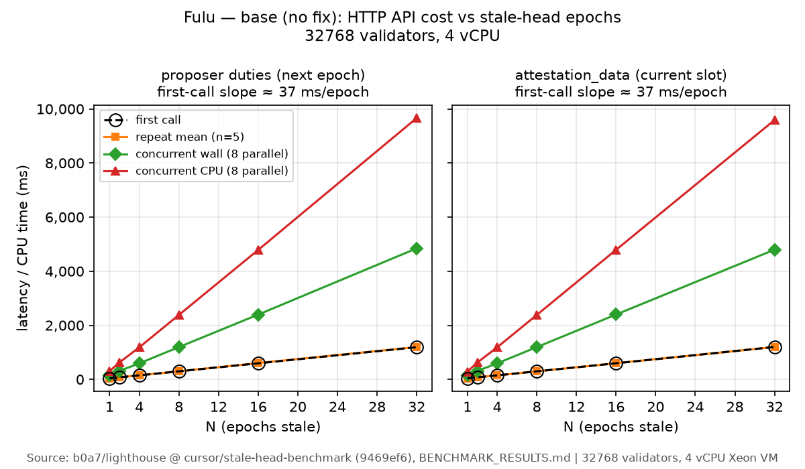
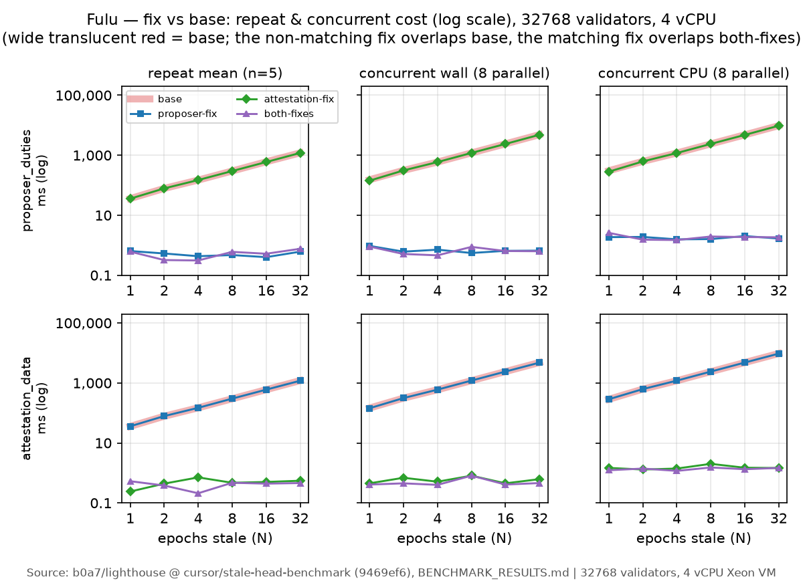

# Stale-head HTTP API cost benchmark (#9530)

Evidence-only results for [sigp/lighthouse#9530](https://github.com/sigp/lighthouse/issues/9530).
**Not intended to be merged.**

## Reproduce

```bash
# Extended harness lives on cursor/stale-head-benchmark-v2 (forked from the frozen
# public tip cursor/stale-head-benchmark @ 4504e7bdf). Do not push to the frozen branch.
git fetch origin cursor/stale-head-benchmark-v2
git checkout cursor/stale-head-benchmark-v2

# Release build; http_api integration tests are compiled out in debug.
RUST_LOG=error \
STALE_HEAD_BENCH_VALIDATORS=32768 \
STALE_HEAD_BENCH_VARIANT=base-v2 \
STALE_HEAD_BENCH_FORKS=fulu,gloas \
cargo test -p http_api --release --test bn_http_api_tests \
  stale_head_http_api_benchmark -- --ignored --nocapture

# Epoch-by-epoch incremental cost (main #9530 claim):
RUST_LOG=error \
STALE_HEAD_BENCH_VALIDATORS=32768 \
STALE_HEAD_BENCH_VARIANT=base-v2 \
STALE_HEAD_BENCH_FORKS=fulu,gloas \
cargo test -p http_api --release --test bn_http_api_tests \
  stale_head_incremental_epoch_benchmark -- --ignored --nocapture
```

To compare against the advanced-state fix, use the merge branch
`cursor/stale-head-benchmark-advanced-state` (= this v2 harness merged with
`cursor/stale-head-advanced-state`) and set `STALE_HEAD_BENCH_VARIANT=advanced-state`.

Historical result-cache comparisons (do not modify the frozen `cursor/stale-head-benchmark`):

```bash
# + proposer duties fix
git cherry-pick 658aa05d71d65548ff8402190eabbaa72f3ee27f

# + attestation_data fix
git cherry-pick b28a774745ee302c9252e09ee7d1878d499b6624
```

## Environment

| Item | Value |
|---|---|
| Benchmark branch | `cursor/stale-head-benchmark` @ `1682fddf29e87d4b6ef7d9e5995d7634a34e0b1c` |
| Unstable base | `ef55e2fbf` (`Unschedule Gloas on Hoodi`) |
| Proposer-duties fix | `658aa05d71d65548ff8402190eabbaa72f3ee27f` (from `cursor/proposer-duties-next-epoch-cache`) |
| Attestation-data fix | `b28a774745ee302c9252e09ee7d1878d499b6624` (from `cursor/attestation-data-stale-head-cache`) |
| CPU | 4× Intel Xeon (VM), `available_parallelism=4` |
| Memory | 15 GiB |
| OS | Linux 6.12 / Ubuntu 24.04 |
| Rust | `rustc 1.99.1` |
| Validators | **32768** (MainnetEthSpec; 64k hit the old 5s HTTP timeout on concurrent N=32 before the bench raised client timeouts to 120s) |
| Setup | 3 epochs of chain with 64 attesters/slot, then jump wall clock by N epochs with no new blocks |
| Repeat / concurrent | 5 sequential repeats; 8 parallel identical calls (warm after first) |
| Endpoints | `GET /eth/v1/validator/duties/proposer/{current+1}`, `GET /eth/v1/validator/attestation_data` at current slot |

## Findings (short)

Cost scales **roughly linearly with staleness N** on both Fulu and Gloas: first-call time ≈ `c × N` (Fulu ≈ 37 ms/epoch, Gloas ≈ 300 ms/epoch on this machine — Gloas is ~8× more expensive per epoch). Without fixes, every repeat and every concurrent caller re-pays that full advance (concurrent wall ≈ 4× first on 4 CPUs; concurrent CPU ≈ 8× first). With the matching fix, **repeat and concurrent drop to sub-millisecond** (roughly **10³–10⁴×** cheaper than the uncached path at N=32) while first-call cost is unchanged.

---

## Variant 1 — bench alone (`ef55e2fbf` + benchmark)

### stale-head benchmark variant=`base` validators=32768

| fork | endpoint | stale_epochs | first_ms | repeat_mean_ms (n=5) | repeat_total_ms | concurrent_wall_ms (n=8) | concurrent_cpu_ms |
|---|---|---:|---:|---:|---:|---:|---:|
| fulu | proposer_duties(next_epoch) | 1 | 37.32 | 35.88 | 179.42 | 152.47 | 304.41 |
| fulu | attestation_data(current_slot) | 1 | 36.39 | 35.69 | 178.46 | 145.50 | 285.14 |
| fulu | proposer_duties(next_epoch) | 2 | 78.02 | 78.25 | 391.23 | 312.52 | 624.23 |
| fulu | attestation_data(current_slot) | 2 | 77.88 | 77.63 | 388.13 | 312.25 | 622.52 |
| fulu | proposer_duties(next_epoch) | 4 | 149.26 | 148.38 | 741.88 | 592.26 | 1184.42 |
| fulu | attestation_data(current_slot) | 4 | 148.50 | 148.35 | 741.73 | 593.00 | 1184.16 |
| fulu | proposer_duties(next_epoch) | 8 | 299.15 | 297.85 | 1489.26 | 1194.96 | 2383.55 |
| fulu | attestation_data(current_slot) | 8 | 298.14 | 296.94 | 1484.72 | 1192.33 | 2381.82 |
| fulu | proposer_duties(next_epoch) | 16 | 593.86 | 604.58 | 3022.88 | 2395.72 | 4784.95 |
| fulu | attestation_data(current_slot) | 16 | 595.87 | 596.73 | 2983.63 | 2396.96 | 4787.95 |
| fulu | proposer_duties(next_epoch) | 32 | 1190.66 | 1196.39 | 5981.96 | 4844.43 | 9662.30 |
| fulu | attestation_data(current_slot) | 32 | 1198.25 | 1197.63 | 5988.14 | 4795.33 | 9587.17 |
| gloas | proposer_duties(next_epoch) | 1 | 301.66 | 299.28 | 1496.38 | 1260.12 | 2456.77 |
| gloas | attestation_data(current_slot) | 1 | 299.62 | 301.40 | 1506.99 | 1193.52 | 2385.17 |
| gloas | proposer_duties(next_epoch) | 2 | 600.76 | 606.17 | 3030.86 | 2423.29 | 4819.85 |
| gloas | attestation_data(current_slot) | 2 | 605.09 | 610.15 | 3050.74 | 2428.99 | 4853.90 |
| gloas | proposer_duties(next_epoch) | 4 | 1219.29 | 1218.00 | 6089.98 | 4880.46 | 9760.37 |
| gloas | attestation_data(current_slot) | 4 | 1222.01 | 1225.26 | 6126.31 | 4901.28 | 9774.18 |
| gloas | proposer_duties(next_epoch) | 8 | 2426.27 | 2438.92 | 12194.62 | 9724.97 | 19398.83 |
| gloas | attestation_data(current_slot) | 8 | 2446.45 | 2438.08 | 12190.41 | 9859.70 | 19638.85 |
| gloas | proposer_duties(next_epoch) | 16 | 4886.46 | 4897.16 | 24485.79 | 19632.97 | 39239.60 |
| gloas | attestation_data(current_slot) | 16 | 4944.12 | 4978.75 | 24893.75 | 20014.40 | 39567.61 |
| gloas | proposer_duties(next_epoch) | 32 | 9714.72 | 9984.93 | 49924.66 | 39780.44 | 78992.98 |
| gloas | attestation_data(current_slot) | 32 | 9831.15 | 9965.87 | 49829.34 | 40216.79 | 79767.38 |

---

## Variant 2 — bench + proposer-duties fix

Cherry-pick: `658aa05d71d65548ff8402190eabbaa72f3ee27f`

### stale-head benchmark variant=`proposer-fix` validators=32768

| fork | endpoint | stale_epochs | first_ms | repeat_mean_ms (n=5) | repeat_total_ms | concurrent_wall_ms (n=8) | concurrent_cpu_ms |
|---|---|---:|---:|---:|---:|---:|---:|
| fulu | proposer_duties(next_epoch) | 1 | 36.97 | 0.64 | 3.20 | 0.95 | 1.86 |
| fulu | attestation_data(current_slot) | 1 | 35.89 | 35.95 | 179.74 | 143.54 | 286.28 |
| fulu | proposer_duties(next_epoch) | 2 | 78.09 | 0.53 | 2.64 | 0.61 | 1.89 |
| fulu | attestation_data(current_slot) | 2 | 78.71 | 78.57 | 392.84 | 313.43 | 623.65 |
| fulu | proposer_duties(next_epoch) | 4 | 148.82 | 0.43 | 2.16 | 0.71 | 1.57 |
| fulu | attestation_data(current_slot) | 4 | 147.70 | 148.23 | 741.16 | 598.17 | 1193.11 |
| fulu | proposer_duties(next_epoch) | 8 | 297.48 | 0.47 | 2.37 | 0.55 | 1.60 |
| fulu | attestation_data(current_slot) | 8 | 297.34 | 300.24 | 1501.20 | 1199.66 | 2392.70 |
| fulu | proposer_duties(next_epoch) | 16 | 596.35 | 0.40 | 1.99 | 0.65 | 2.02 |
| fulu | attestation_data(current_slot) | 16 | 602.26 | 597.89 | 2989.45 | 2397.59 | 4782.73 |
| fulu | proposer_duties(next_epoch) | 32 | 1181.39 | 0.61 | 3.03 | 0.66 | 1.67 |
| fulu | attestation_data(current_slot) | 32 | 1190.08 | 1185.18 | 5925.89 | 4754.30 | 9497.00 |
| gloas | proposer_duties(next_epoch) | 1 | 299.60 | 0.69 | 3.44 | 1.39 | 2.73 |
| gloas | attestation_data(current_slot) | 1 | 300.26 | 300.21 | 1501.03 | 1207.88 | 2403.67 |
| gloas | proposer_duties(next_epoch) | 2 | 588.48 | 0.71 | 3.55 | 0.87 | 2.03 |
| gloas | attestation_data(current_slot) | 2 | 603.27 | 598.62 | 2993.12 | 2388.48 | 4767.94 |
| gloas | proposer_duties(next_epoch) | 4 | 1206.89 | 0.71 | 3.55 | 0.65 | 1.99 |
| gloas | attestation_data(current_slot) | 4 | 1223.46 | 1229.37 | 6146.86 | 4887.85 | 9751.83 |
| gloas | proposer_duties(next_epoch) | 8 | 2413.48 | 0.69 | 3.47 | 0.75 | 2.05 |
| gloas | attestation_data(current_slot) | 8 | 2455.73 | 2435.77 | 12178.85 | 9765.18 | 19505.42 |
| gloas | proposer_duties(next_epoch) | 16 | 4880.92 | 0.70 | 3.52 | 0.69 | 2.08 |
| gloas | attestation_data(current_slot) | 16 | 4981.95 | 4958.27 | 24791.33 | 19841.34 | 39615.98 |
| gloas | proposer_duties(next_epoch) | 32 | 9895.19 | 0.81 | 4.03 | 0.82 | 2.15 |
| gloas | attestation_data(current_slot) | 32 | 10107.02 | 10109.44 | 50547.21 | 40086.28 | 79543.96 |

---

## Variant 3 — bench + attestation-data fix

Cherry-pick: `b28a774745ee302c9252e09ee7d1878d499b6624`

### stale-head benchmark variant=`attestation-fix` validators=32768

| fork | endpoint | stale_epochs | first_ms | repeat_mean_ms (n=5) | repeat_total_ms | concurrent_wall_ms (n=8) | concurrent_cpu_ms |
|---|---|---:|---:|---:|---:|---:|---:|
| fulu | proposer_duties(next_epoch) | 1 | 36.40 | 35.62 | 178.09 | 141.83 | 282.89 |
| fulu | attestation_data(current_slot) | 1 | 35.84 | 0.24 | 1.19 | 0.45 | 1.47 |
| fulu | proposer_duties(next_epoch) | 2 | 78.03 | 78.40 | 392.01 | 311.21 | 621.26 |
| fulu | attestation_data(current_slot) | 2 | 78.33 | 0.44 | 2.19 | 0.69 | 1.30 |
| fulu | proposer_duties(next_epoch) | 4 | 148.44 | 148.78 | 743.88 | 591.18 | 1181.87 |
| fulu | attestation_data(current_slot) | 4 | 148.61 | 0.71 | 3.55 | 0.51 | 1.40 |
| fulu | proposer_duties(next_epoch) | 8 | 296.35 | 296.95 | 1484.76 | 1193.42 | 2382.26 |
| fulu | attestation_data(current_slot) | 8 | 297.54 | 0.47 | 2.37 | 0.81 | 2.01 |
| fulu | proposer_duties(next_epoch) | 16 | 592.50 | 592.40 | 2962.02 | 2376.66 | 4751.90 |
| fulu | attestation_data(current_slot) | 16 | 591.66 | 0.50 | 2.52 | 0.45 | 1.49 |
| fulu | proposer_duties(next_epoch) | 32 | 1178.04 | 1192.77 | 5963.87 | 4811.64 | 9617.52 |
| fulu | attestation_data(current_slot) | 32 | 1187.38 | 0.55 | 2.77 | 0.62 | 1.46 |
| gloas | proposer_duties(next_epoch) | 1 | 297.87 | 294.62 | 1473.10 | 1199.43 | 2380.92 |
| gloas | attestation_data(current_slot) | 1 | 295.02 | 0.43 | 2.14 | 0.52 | 1.68 |
| gloas | proposer_duties(next_epoch) | 2 | 601.19 | 591.97 | 2959.87 | 2407.36 | 4782.92 |
| gloas | attestation_data(current_slot) | 2 | 597.79 | 0.69 | 3.44 | 0.50 | 1.61 |
| gloas | proposer_duties(next_epoch) | 4 | 1207.79 | 1226.35 | 6131.73 | 4869.40 | 9703.79 |
| gloas | attestation_data(current_slot) | 4 | 1203.03 | 0.71 | 3.53 | 0.59 | 1.80 |
| gloas | proposer_duties(next_epoch) | 8 | 2528.95 | 2418.64 | 12093.18 | 9722.74 | 19437.55 |
| gloas | attestation_data(current_slot) | 8 | 2420.03 | 0.69 | 3.45 | 0.52 | 1.77 |
| gloas | proposer_duties(next_epoch) | 16 | 4929.05 | 4892.66 | 24463.31 | 19657.73 | 39229.75 |
| gloas | attestation_data(current_slot) | 16 | 4819.05 | 0.61 | 3.06 | 0.57 | 1.65 |
| gloas | proposer_duties(next_epoch) | 32 | 9725.98 | 10071.68 | 50358.38 | 39546.23 | 78922.32 |
| gloas | attestation_data(current_slot) | 32 | 9785.52 | 0.90 | 4.51 | 0.94 | 2.11 |

---

## Variant 4 — bench + both fixes

Cherry-picks: `658aa05d7` then `b28a77474`

### stale-head benchmark variant=`both-fixes` validators=32768

| fork | endpoint | stale_epochs | first_ms | repeat_mean_ms (n=5) | repeat_total_ms | concurrent_wall_ms (n=8) | concurrent_cpu_ms |
|---|---|---:|---:|---:|---:|---:|---:|
| fulu | proposer_duties(next_epoch) | 1 | 37.16 | 0.61 | 3.05 | 0.90 | 2.58 |
| fulu | attestation_data(current_slot) | 1 | 36.11 | 0.53 | 2.63 | 0.41 | 1.23 |
| fulu | proposer_duties(next_epoch) | 2 | 78.89 | 0.32 | 1.61 | 0.51 | 1.53 |
| fulu | attestation_data(current_slot) | 2 | 80.76 | 0.38 | 1.91 | 0.45 | 1.40 |
| fulu | proposer_duties(next_epoch) | 4 | 151.05 | 0.31 | 1.56 | 0.46 | 1.49 |
| fulu | attestation_data(current_slot) | 4 | 150.63 | 0.21 | 1.06 | 0.40 | 1.17 |
| fulu | proposer_duties(next_epoch) | 8 | 301.11 | 0.60 | 3.00 | 0.88 | 1.95 |
| fulu | attestation_data(current_slot) | 8 | 301.26 | 0.47 | 2.33 | 0.81 | 1.52 |
| fulu | proposer_duties(next_epoch) | 16 | 602.70 | 0.52 | 2.60 | 0.64 | 1.87 |
| fulu | attestation_data(current_slot) | 16 | 601.80 | 0.44 | 2.22 | 0.41 | 1.33 |
| fulu | proposer_duties(next_epoch) | 32 | 1194.27 | 0.76 | 3.80 | 0.63 | 1.84 |
| fulu | attestation_data(current_slot) | 32 | 1193.71 | 0.46 | 2.32 | 0.46 | 1.47 |
| gloas | proposer_duties(next_epoch) | 1 | 297.04 | 0.45 | 2.23 | 0.93 | 2.53 |
| gloas | attestation_data(current_slot) | 1 | 294.33 | 0.53 | 2.66 | 0.84 | 1.77 |
| gloas | proposer_duties(next_epoch) | 2 | 605.51 | 0.61 | 3.05 | 0.48 | 1.53 |
| gloas | attestation_data(current_slot) | 2 | 596.15 | 0.54 | 2.69 | 0.60 | 1.53 |
| gloas | proposer_duties(next_epoch) | 4 | 1235.38 | 0.73 | 3.63 | 0.68 | 2.09 |
| gloas | attestation_data(current_slot) | 4 | 1212.28 | 0.28 | 1.40 | 1.06 | 1.69 |
| gloas | proposer_duties(next_epoch) | 8 | 2422.73 | 0.68 | 3.38 | 1.47 | 1.91 |
| gloas | attestation_data(current_slot) | 8 | 2403.30 | 0.60 | 2.99 | 0.47 | 1.59 |
| gloas | proposer_duties(next_epoch) | 16 | 4900.84 | 0.66 | 3.31 | 0.65 | 1.75 |
| gloas | attestation_data(current_slot) | 16 | 4806.46 | 0.74 | 3.71 | 0.58 | 1.68 |
| gloas | proposer_duties(next_epoch) | 32 | 9813.34 | 0.80 | 3.99 | 0.99 | 2.18 |
| gloas | attestation_data(current_slot) | 32 | 9684.46 | 0.83 | 4.13 | 0.59 | 1.70 |

---

## Highlight: N=32 Gloas (worst row)

| Variant | Endpoint | first_ms | repeat_mean_ms | concurrent_wall_ms | concurrent_cpu_ms |
|---|---|---:|---:|---:|---:|
| base | proposer_duties | 9714.72 | 9984.93 | 39780.44 | 78992.98 |
| base | attestation_data | 9831.15 | 9965.87 | 40216.79 | 79767.38 |
| proposer-fix | proposer_duties | 9895.19 | **0.81** | **0.82** | **2.15** |
| proposer-fix | attestation_data | 10107.02 | 10109.44 | 40086.28 | 79543.96 |
| attestation-fix | proposer_duties | 9725.98 | 10071.68 | 39546.23 | 78922.32 |
| attestation-fix | attestation_data | 9785.52 | **0.90** | **0.94** | **2.11** |
| both-fixes | proposer_duties | 9813.34 | **0.80** | **0.99** | **2.18** |
| both-fixes | attestation_data | 9684.46 | **0.83** | **0.59** | **1.70** |

---

## Graphs

See [`benchmark-graphs/README.md`](benchmark-graphs/README.md) for the full set of plots (Fulu and Gloas, base scaling and fix-vs-base).





---

## Variant 5 — extended harness v2 (`cursor/stale-head-benchmark-v2`, base)

Branch tip after harness extension; run against `ef55e2fbf` + harness only (no advanced-state fix).
New endpoints: attester duties, block production (v3/v4), `states/{slot}/validators` past the head.
Also records epoch-by-epoch incremental first-call cost (main #9530 claim for the fix branch).

Harness SHA: `db4a841f9c163b5b282836f263ccbf6b80b58aa6`
Frozen public tip left untouched: `cursor/stale-head-benchmark` @ `4504e7bdf572fda0ae54064dcf6285bde5dbbcb6`

### stale-head benchmark variant=`base-v2` validators=32768
| fork | endpoint | stale_epochs | first_ms | repeat_mean_ms (n=5) | repeat_total_ms | concurrent_wall_ms (n=8) | concurrent_cpu_ms |
|---|---|---:|---:|---:|---:|---:|---:|
| fulu | proposer_duties(next_epoch) | 1 | 43.23 | 50.68 | 253.41 | 244.43 | 330.44 |
| fulu | attestation_data(current_slot) | 1 | 37.16 | 46.61 | 233.04 | 228.48 | 297.33 |
| fulu | attester_duties(current_epoch) | 1 | 83.92 | 108.63 | 543.13 | 561.61 | 608.96 |
| fulu | block_production(v3) | 1 | 363.55 | 383.66 | 1918.32 | 1546.12 | 541.00 |
| fulu | states/{slot}/validators(past_head) | 1 | 131.75 | 114.96 | 574.78 | 543.11 | 644.04 |
| fulu | proposer_duties(next_epoch) | 2 | 95.10 | 107.32 | 536.61 | 495.28 | 654.91 |
| fulu | attestation_data(current_slot) | 2 | 81.35 | 96.37 | 481.84 | 467.11 | 643.69 |
| fulu | attester_duties(current_epoch) | 2 | 118.71 | 76.15 | 380.76 | 465.82 | 600.36 |
| fulu | block_production(v3) | 2 | 406.77 | 436.41 | 2182.04 | 1990.34 | 1094.52 |
| fulu | states/{slot}/validators(past_head) | 2 | 118.00 | 118.91 | 594.54 | 521.67 | 645.84 |
| fulu | proposer_duties(next_epoch) | 4 | 235.40 | 204.14 | 1020.70 | 1306.98 | 1239.60 |
| fulu | attestation_data(current_slot) | 4 | 211.66 | 274.23 | 1371.17 | 1184.02 | 1225.11 |
| fulu | attester_duties(current_epoch) | 4 | 438.27 | 138.43 | 692.14 | 655.38 | 604.31 |
| fulu | block_production(v3) | 4 | 553.49 | 660.84 | 3304.22 | 3944.58 | 1961.94 |
| fulu | states/{slot}/validators(past_head) | 4 | 158.16 | 118.42 | 592.10 | 552.95 | 627.49 |
| fulu | proposer_duties(next_epoch) | 8 | 326.29 | 350.81 | 1754.07 | 1933.03 | 2455.76 |
| fulu | attestation_data(current_slot) | 8 | 334.58 | 331.46 | 1657.31 | 1982.45 | 2474.24 |
| fulu | attester_duties(current_epoch) | 8 | 433.81 | 149.65 | 748.27 | 496.68 | 595.37 |
| fulu | block_production(v3) | 8 | 929.43 | 792.42 | 3962.11 | 2901.19 | 3703.37 |
| fulu | states/{slot}/validators(past_head) | 8 | 91.08 | 76.73 | 383.65 | 397.82 | 646.58 |
| fulu | proposer_duties(next_epoch) | 16 | 609.56 | 675.76 | 3378.78 | 2421.22 | 4830.42 |
| fulu | attestation_data(current_slot) | 16 | 602.14 | 628.32 | 3141.61 | 2894.61 | 4790.80 |
| fulu | attester_duties(current_epoch) | 16 | 658.35 | 77.11 | 385.54 | 308.22 | 577.85 |
| fulu | block_production(v3) | 16 | 1109.65 | 1101.96 | 5509.81 | 4733.84 | 7253.79 |
| fulu | states/{slot}/validators(past_head) | 16 | 110.50 | 78.99 | 394.95 | 400.24 | 643.88 |
| fulu | proposer_duties(next_epoch) | 32 | 1208.63 | 1200.37 | 6001.83 | 4795.10 | 9574.03 |
| fulu | attestation_data(current_slot) | 32 | 1209.62 | 1209.08 | 6045.40 | 5016.23 | 9859.04 |
| fulu | attester_duties(current_epoch) | 32 | 1260.18 | 85.00 | 424.98 | 321.17 | 621.46 |
| fulu | block_production(v3) | 32 | 1956.01 | 1934.14 | 9670.69 | 8285.31 | 14368.47 |
| fulu | states/{slot}/validators(past_head) | 32 | 101.25 | 77.08 | 385.38 | 399.67 | 640.59 |
| gloas | proposer_duties(next_epoch) | 1 | 416.62 | 429.07 | 2145.33 | 2546.37 | 2654.95 |
| gloas | attestation_data(current_slot) | 1 | 618.84 | 583.88 | 2919.40 | 2406.21 | 2674.62 |
| gloas | attester_duties(current_epoch) | 1 | 168.51 | 131.91 | 659.57 | 616.24 | 621.29 |
| gloas | block_production(v4) | 1 | 837.92 | 889.57 | 4447.83 | 3755.43 | 2962.89 |
| gloas | states/{slot}/validators(past_head) | 1 | 158.64 | 139.33 | 696.63 | 736.14 | 666.68 |
| gloas | proposer_duties(next_epoch) | 2 | 766.44 | 889.76 | 4448.82 | 4732.69 | 5166.82 |
| gloas | attestation_data(current_slot) | 2 | 1098.83 | 901.58 | 4507.91 | 2470.99 | 4927.27 |
| gloas | attester_duties(current_epoch) | 2 | 413.35 | 72.78 | 363.90 | 343.96 | 568.84 |
| gloas | block_production(v4) | 2 | 945.10 | 975.05 | 4875.27 | 3785.07 | 5568.12 |
| gloas | states/{slot}/validators(past_head) | 2 | 108.84 | 89.28 | 446.38 | 411.29 | 693.68 |
| gloas | proposer_duties(next_epoch) | 4 | 1292.81 | 1280.68 | 6403.40 | 5071.53 | 10133.84 |
| gloas | attestation_data(current_slot) | 4 | 1274.52 | 1306.52 | 6532.62 | 5158.09 | 10314.11 |
| gloas | attester_duties(current_epoch) | 4 | 1025.05 | 75.04 | 375.22 | 302.96 | 597.08 |
| gloas | block_production(v4) | 4 | 1633.13 | 1647.22 | 8236.08 | 6610.33 | 11245.95 |
| gloas | states/{slot}/validators(past_head) | 4 | 105.71 | 83.32 | 416.62 | 394.74 | 699.59 |
| gloas | proposer_duties(next_epoch) | 8 | 2505.49 | 2528.54 | 12642.72 | 10231.70 | 20409.11 |
| gloas | attestation_data(current_slot) | 8 | 2567.43 | 2593.36 | 12966.81 | 10257.88 | 20434.70 |
| gloas | attester_duties(current_epoch) | 8 | 2477.45 | 77.89 | 389.46 | 320.74 | 618.61 |
| gloas | block_production(v4) | 8 | 3215.56 | 3078.76 | 15393.78 | 12267.19 | 22789.38 |
| gloas | states/{slot}/validators(past_head) | 8 | 93.90 | 80.14 | 400.69 | 400.47 | 725.60 |
| gloas | proposer_duties(next_epoch) | 16 | 5193.91 | 5136.47 | 25682.37 | 20627.29 | 41005.68 |
| gloas | attestation_data(current_slot) | 16 | 5314.71 | 5258.47 | 26292.37 | 20858.21 | 41527.98 |
| gloas | attester_duties(current_epoch) | 16 | 4830.68 | 76.10 | 380.52 | 312.00 | 619.41 |
| gloas | block_production(v4) | 16 | 5836.73 | 5776.36 | 28881.82 | 23250.38 | 44762.88 |
| gloas | states/{slot}/validators(past_head) | 16 | 114.93 | 79.50 | 397.51 | 399.45 | 715.95 |
| gloas | proposer_duties(next_epoch) | 32 | 10290.92 | 10181.96 | 50909.78 | 40634.34 | 81245.23 |
| gloas | attestation_data(current_slot) | 32 | 10307.50 | 10476.51 | 52382.57 | 41588.01 | 83114.55 |
| gloas | attester_duties(current_epoch) | 32 | 9951.14 | 79.88 | 399.41 | 318.49 | 644.00 |
| gloas | block_production(v4) | 32 | 11419.46 | 11520.30 | 57601.48 | 46804.90 | 92424.21 |
| gloas | states/{slot}/validators(past_head) | 32 | 131.03 | 87.13 | 435.63 | 393.44 | 721.26 |

### stale-head epoch-by-epoch incremental variant=`base-v2` validators=32768
| fork | endpoint | stale_epochs | first_ms |
|---|---|---:|---:|
| fulu | proposer_duties(next_epoch) | 1 | 48.40 |
| fulu | attestation_data(current_slot) | 1 | 43.28 |
| fulu | attester_duties(current_epoch) | 1 | 87.77 |
| fulu | block_production(v3) | 1 | 331.97 |
| fulu | states/{slot}/validators(past_head) | 1 | 109.40 |
| fulu | proposer_duties(next_epoch) | 2 | 99.25 |
| fulu | attestation_data(current_slot) | 2 | 92.06 |
| fulu | attester_duties(current_epoch) | 2 | 121.27 |
| fulu | block_production(v3) | 2 | 396.21 |
| fulu | states/{slot}/validators(past_head) | 2 | 99.23 |
| fulu | proposer_duties(next_epoch) | 3 | 139.15 |
| fulu | attestation_data(current_slot) | 3 | 122.01 |
| fulu | attester_duties(current_epoch) | 3 | 155.89 |
| fulu | block_production(v3) | 3 | 436.78 |
| fulu | states/{slot}/validators(past_head) | 3 | 94.09 |
| fulu | proposer_duties(next_epoch) | 4 | 165.47 |
| fulu | attestation_data(current_slot) | 4 | 175.29 |
| fulu | attester_duties(current_epoch) | 4 | 199.07 |
| fulu | block_production(v3) | 4 | 491.93 |
| fulu | states/{slot}/validators(past_head) | 4 | 84.11 |
| fulu | proposer_duties(next_epoch) | 5 | 207.18 |
| fulu | attestation_data(current_slot) | 5 | 193.06 |
| fulu | attester_duties(current_epoch) | 5 | 238.22 |
| fulu | block_production(v3) | 5 | 567.58 |
| fulu | states/{slot}/validators(past_head) | 5 | 84.92 |
| fulu | proposer_duties(next_epoch) | 6 | 254.59 |
| fulu | attestation_data(current_slot) | 6 | 241.17 |
| fulu | attester_duties(current_epoch) | 6 | 274.16 |
| fulu | block_production(v3) | 6 | 621.73 |
| fulu | states/{slot}/validators(past_head) | 6 | 86.64 |
| fulu | proposer_duties(next_epoch) | 7 | 299.84 |
| fulu | attestation_data(current_slot) | 7 | 292.26 |
| fulu | attester_duties(current_epoch) | 7 | 332.40 |
| fulu | block_production(v3) | 7 | 684.13 |
| fulu | states/{slot}/validators(past_head) | 7 | 87.31 |
| fulu | proposer_duties(next_epoch) | 8 | 343.32 |
| fulu | attestation_data(current_slot) | 8 | 345.97 |
| fulu | attester_duties(current_epoch) | 8 | 385.70 |
| fulu | block_production(v3) | 8 | 763.83 |
| fulu | states/{slot}/validators(past_head) | 8 | 85.04 |
| fulu | proposer_duties(next_epoch) | 9 | 371.36 |
| fulu | attestation_data(current_slot) | 9 | 372.74 |
| fulu | attester_duties(current_epoch) | 9 | 416.00 |
| fulu | block_production(v3) | 9 | 761.40 |
| fulu | states/{slot}/validators(past_head) | 9 | 80.95 |
| fulu | proposer_duties(next_epoch) | 10 | 392.26 |
| fulu | attestation_data(current_slot) | 10 | 390.49 |
| fulu | attester_duties(current_epoch) | 10 | 439.56 |
| fulu | block_production(v3) | 10 | 820.19 |
| fulu | states/{slot}/validators(past_head) | 10 | 75.84 |
| fulu | proposer_duties(next_epoch) | 11 | 435.80 |
| fulu | attestation_data(current_slot) | 11 | 430.18 |
| fulu | attester_duties(current_epoch) | 11 | 457.34 |
| fulu | block_production(v3) | 11 | 860.50 |
| fulu | states/{slot}/validators(past_head) | 11 | 79.72 |
| fulu | proposer_duties(next_epoch) | 12 | 476.87 |
| fulu | attestation_data(current_slot) | 12 | 464.89 |
| fulu | attester_duties(current_epoch) | 12 | 507.24 |
| fulu | block_production(v3) | 12 | 931.95 |
| fulu | states/{slot}/validators(past_head) | 12 | 76.52 |
| fulu | proposer_duties(next_epoch) | 13 | 523.72 |
| fulu | attestation_data(current_slot) | 13 | 511.40 |
| fulu | attester_duties(current_epoch) | 13 | 550.31 |
| fulu | block_production(v3) | 13 | 975.69 |
| fulu | states/{slot}/validators(past_head) | 13 | 79.38 |
| fulu | proposer_duties(next_epoch) | 14 | 558.00 |
| fulu | attestation_data(current_slot) | 14 | 553.34 |
| fulu | attester_duties(current_epoch) | 14 | 583.67 |
| fulu | block_production(v3) | 14 | 1038.01 |
| fulu | states/{slot}/validators(past_head) | 14 | 74.02 |
| fulu | proposer_duties(next_epoch) | 15 | 591.88 |
| fulu | attestation_data(current_slot) | 15 | 604.21 |
| fulu | attester_duties(current_epoch) | 15 | 646.76 |
| fulu | block_production(v3) | 15 | 1118.75 |
| fulu | states/{slot}/validators(past_head) | 15 | 81.20 |
| fulu | proposer_duties(next_epoch) | 16 | 636.70 |
| fulu | attestation_data(current_slot) | 16 | 614.94 |
| fulu | attester_duties(current_epoch) | 16 | 667.05 |
| fulu | block_production(v3) | 16 | 1187.97 |
| fulu | states/{slot}/validators(past_head) | 16 | 73.80 |
| fulu | proposer_duties(next_epoch) | 17 | 681.72 |
| fulu | attestation_data(current_slot) | 17 | 681.99 |
| fulu | attester_duties(current_epoch) | 17 | 700.60 |
| fulu | block_production(v3) | 17 | 1194.96 |
| fulu | states/{slot}/validators(past_head) | 17 | 77.34 |
| fulu | proposer_duties(next_epoch) | 18 | 710.48 |
| fulu | attestation_data(current_slot) | 18 | 693.17 |
| fulu | attester_duties(current_epoch) | 18 | 752.74 |
| fulu | block_production(v3) | 18 | 1267.95 |
| fulu | states/{slot}/validators(past_head) | 18 | 77.38 |
| fulu | proposer_duties(next_epoch) | 19 | 776.08 |
| fulu | attestation_data(current_slot) | 19 | 756.89 |
| fulu | attester_duties(current_epoch) | 19 | 837.11 |
| fulu | block_production(v3) | 19 | 1406.27 |
| fulu | states/{slot}/validators(past_head) | 19 | 83.10 |
| fulu | proposer_duties(next_epoch) | 20 | 821.09 |
| fulu | attestation_data(current_slot) | 20 | 826.01 |
| fulu | attester_duties(current_epoch) | 20 | 862.03 |
| fulu | block_production(v3) | 20 | 1407.10 |
| fulu | states/{slot}/validators(past_head) | 20 | 77.67 |
| fulu | proposer_duties(next_epoch) | 21 | 850.96 |
| fulu | attestation_data(current_slot) | 21 | 852.17 |
| fulu | attester_duties(current_epoch) | 21 | 905.73 |
| fulu | block_production(v3) | 21 | 1474.60 |
| fulu | states/{slot}/validators(past_head) | 21 | 79.60 |
| fulu | proposer_duties(next_epoch) | 22 | 884.59 |
| fulu | attestation_data(current_slot) | 22 | 882.63 |
| fulu | attester_duties(current_epoch) | 22 | 924.38 |
| fulu | block_production(v3) | 22 | 1501.84 |
| fulu | states/{slot}/validators(past_head) | 22 | 79.54 |
| fulu | proposer_duties(next_epoch) | 23 | 894.36 |
| fulu | attestation_data(current_slot) | 23 | 912.50 |
| fulu | attester_duties(current_epoch) | 23 | 974.51 |
| fulu | block_production(v3) | 23 | 1568.22 |
| fulu | states/{slot}/validators(past_head) | 23 | 85.78 |
| fulu | proposer_duties(next_epoch) | 24 | 954.74 |
| fulu | attestation_data(current_slot) | 24 | 951.15 |
| fulu | attester_duties(current_epoch) | 24 | 1073.76 |
| fulu | block_production(v3) | 24 | 1651.99 |
| fulu | states/{slot}/validators(past_head) | 24 | 98.35 |
| fulu | proposer_duties(next_epoch) | 25 | 1008.37 |
| fulu | attestation_data(current_slot) | 25 | 1003.54 |
| fulu | attester_duties(current_epoch) | 25 | 1055.91 |
| fulu | block_production(v3) | 25 | 1655.88 |
| fulu | states/{slot}/validators(past_head) | 25 | 87.14 |
| fulu | proposer_duties(next_epoch) | 26 | 1049.79 |
| fulu | attestation_data(current_slot) | 26 | 1038.80 |
| fulu | attester_duties(current_epoch) | 26 | 1100.97 |
| fulu | block_production(v3) | 26 | 1735.63 |
| fulu | states/{slot}/validators(past_head) | 26 | 85.41 |
| fulu | proposer_duties(next_epoch) | 27 | 1110.33 |
| fulu | attestation_data(current_slot) | 27 | 1087.81 |
| fulu | attester_duties(current_epoch) | 27 | 1166.50 |
| fulu | block_production(v3) | 27 | 1838.63 |
| fulu | states/{slot}/validators(past_head) | 27 | 84.51 |
| fulu | proposer_duties(next_epoch) | 28 | 1179.07 |
| fulu | attestation_data(current_slot) | 28 | 1144.01 |
| fulu | attester_duties(current_epoch) | 28 | 1174.88 |
| fulu | block_production(v3) | 28 | 1867.42 |
| fulu | states/{slot}/validators(past_head) | 28 | 89.50 |
| fulu | proposer_duties(next_epoch) | 29 | 1154.78 |
| fulu | attestation_data(current_slot) | 29 | 1162.18 |
| fulu | attester_duties(current_epoch) | 29 | 1198.69 |
| fulu | block_production(v3) | 29 | 1930.01 |
| fulu | states/{slot}/validators(past_head) | 29 | 106.24 |
| fulu | proposer_duties(next_epoch) | 30 | 1227.56 |
| fulu | attestation_data(current_slot) | 30 | 1249.45 |
| fulu | attester_duties(current_epoch) | 30 | 1233.75 |
| fulu | block_production(v3) | 30 | 2035.51 |
| fulu | states/{slot}/validators(past_head) | 30 | 85.50 |
| fulu | proposer_duties(next_epoch) | 31 | 1279.67 |
| fulu | attestation_data(current_slot) | 31 | 1287.92 |
| fulu | attester_duties(current_epoch) | 31 | 1370.55 |
| fulu | block_production(v3) | 31 | 2073.41 |
| fulu | states/{slot}/validators(past_head) | 31 | 84.83 |
| fulu | proposer_duties(next_epoch) | 32 | 1325.87 |
| fulu | attestation_data(current_slot) | 32 | 1274.57 |
| fulu | attester_duties(current_epoch) | 32 | 1319.27 |
| fulu | block_production(v3) | 32 | 2064.97 |
| fulu | states/{slot}/validators(past_head) | 32 | 84.11 |
| gloas | proposer_duties(next_epoch) | 1 | 335.81 |
| gloas | attestation_data(current_slot) | 1 | 340.33 |
| gloas | attester_duties(current_epoch) | 1 | 89.98 |
| gloas | block_production(v4) | 1 | 640.90 |
| gloas | states/{slot}/validators(past_head) | 1 | 119.58 |
| gloas | proposer_duties(next_epoch) | 2 | 661.08 |
| gloas | attestation_data(current_slot) | 2 | 657.79 |
| gloas | attester_duties(current_epoch) | 2 | 420.84 |
| gloas | block_production(v4) | 2 | 972.26 |
| gloas | states/{slot}/validators(past_head) | 2 | 80.86 |
| gloas | proposer_duties(next_epoch) | 3 | 992.10 |
| gloas | attestation_data(current_slot) | 3 | 997.76 |
| gloas | attester_duties(current_epoch) | 3 | 715.91 |
| gloas | block_production(v4) | 3 | 1357.70 |
| gloas | states/{slot}/validators(past_head) | 3 | 84.58 |
| gloas | proposer_duties(next_epoch) | 4 | 1395.13 |
| gloas | attestation_data(current_slot) | 4 | 1385.51 |
| gloas | attester_duties(current_epoch) | 4 | 1114.73 |
| gloas | block_production(v4) | 4 | 1736.61 |
| gloas | states/{slot}/validators(past_head) | 4 | 81.00 |
| gloas | proposer_duties(next_epoch) | 5 | 1671.69 |
| gloas | attestation_data(current_slot) | 5 | 1724.92 |
| gloas | attester_duties(current_epoch) | 5 | 1417.95 |
| gloas | block_production(v4) | 5 | 2091.37 |
| gloas | states/{slot}/validators(past_head) | 5 | 76.77 |
| gloas | proposer_duties(next_epoch) | 6 | 2008.41 |
| gloas | attestation_data(current_slot) | 6 | 2047.93 |
| gloas | attester_duties(current_epoch) | 6 | 1761.24 |
| gloas | block_production(v4) | 6 | 2411.01 |
| gloas | states/{slot}/validators(past_head) | 6 | 84.55 |
| gloas | proposer_duties(next_epoch) | 7 | 2347.02 |
| gloas | attestation_data(current_slot) | 7 | 2485.26 |
| gloas | attester_duties(current_epoch) | 7 | 2139.98 |
| gloas | block_production(v4) | 7 | 2833.21 |
| gloas | states/{slot}/validators(past_head) | 7 | 94.55 |
| gloas | proposer_duties(next_epoch) | 8 | 2750.45 |
| gloas | attestation_data(current_slot) | 8 | 2778.89 |
| gloas | attester_duties(current_epoch) | 8 | 2706.55 |
| gloas | block_production(v4) | 8 | 3178.58 |
| gloas | states/{slot}/validators(past_head) | 8 | 89.56 |
| gloas | proposer_duties(next_epoch) | 9 | 2960.52 |
| gloas | attestation_data(current_slot) | 9 | 3124.56 |
| gloas | attester_duties(current_epoch) | 9 | 2823.18 |
| gloas | block_production(v4) | 9 | 3461.64 |
| gloas | states/{slot}/validators(past_head) | 9 | 86.64 |
| gloas | proposer_duties(next_epoch) | 10 | 3410.05 |
| gloas | attestation_data(current_slot) | 10 | 3406.06 |
| gloas | attester_duties(current_epoch) | 10 | 3146.41 |
| gloas | block_production(v4) | 10 | 3890.80 |
| gloas | states/{slot}/validators(past_head) | 10 | 80.88 |
| gloas | proposer_duties(next_epoch) | 11 | 3674.86 |
| gloas | attestation_data(current_slot) | 11 | 3775.47 |
| gloas | attester_duties(current_epoch) | 11 | 3720.43 |
| gloas | block_production(v4) | 11 | 4603.21 |
| gloas | states/{slot}/validators(past_head) | 11 | 93.39 |
| gloas | proposer_duties(next_epoch) | 12 | 4210.49 |
| gloas | attestation_data(current_slot) | 12 | 4358.71 |
| gloas | attester_duties(current_epoch) | 12 | 3977.43 |
| gloas | block_production(v4) | 12 | 4765.02 |
| gloas | states/{slot}/validators(past_head) | 12 | 91.98 |
| gloas | proposer_duties(next_epoch) | 13 | 4507.83 |
| gloas | attestation_data(current_slot) | 13 | 4650.68 |
| gloas | attester_duties(current_epoch) | 13 | 4392.50 |
| gloas | block_production(v4) | 13 | 5150.94 |
| gloas | states/{slot}/validators(past_head) | 13 | 86.55 |
| gloas | proposer_duties(next_epoch) | 14 | 4915.95 |
| gloas | attestation_data(current_slot) | 14 | 4998.42 |
| gloas | attester_duties(current_epoch) | 14 | 4656.59 |
| gloas | block_production(v4) | 14 | 5584.29 |
| gloas | states/{slot}/validators(past_head) | 14 | 123.42 |
| gloas | proposer_duties(next_epoch) | 15 | 5203.94 |
| gloas | attestation_data(current_slot) | 15 | 5327.14 |
| gloas | attester_duties(current_epoch) | 15 | 5086.91 |
| gloas | block_production(v4) | 15 | 6079.48 |
| gloas | states/{slot}/validators(past_head) | 15 | 103.84 |
| gloas | proposer_duties(next_epoch) | 16 | 5636.51 |
| gloas | attestation_data(current_slot) | 16 | 5680.02 |
| gloas | attester_duties(current_epoch) | 16 | 5234.61 |
| gloas | block_production(v4) | 16 | 6202.68 |
| gloas | states/{slot}/validators(past_head) | 16 | 81.79 |
| gloas | proposer_duties(next_epoch) | 17 | 5682.71 |
| gloas | attestation_data(current_slot) | 17 | 5886.33 |
| gloas | attester_duties(current_epoch) | 17 | 5608.52 |
| gloas | block_production(v4) | 17 | 6563.69 |
| gloas | states/{slot}/validators(past_head) | 17 | 118.67 |
| gloas | proposer_duties(next_epoch) | 18 | 6369.12 |
| gloas | attestation_data(current_slot) | 18 | 6584.22 |
| gloas | attester_duties(current_epoch) | 18 | 6033.89 |
| gloas | block_production(v4) | 18 | 6953.77 |
| gloas | states/{slot}/validators(past_head) | 18 | 142.26 |
| gloas | proposer_duties(next_epoch) | 19 | 6922.60 |
| gloas | attestation_data(current_slot) | 19 | 6844.00 |
| gloas | attester_duties(current_epoch) | 19 | 6424.37 |
| gloas | block_production(v4) | 19 | 7526.65 |
| gloas | states/{slot}/validators(past_head) | 19 | 106.33 |
| gloas | proposer_duties(next_epoch) | 20 | 7151.08 |
| gloas | attestation_data(current_slot) | 20 | 7238.99 |
| gloas | attester_duties(current_epoch) | 20 | 7193.07 |
| gloas | block_production(v4) | 20 | 7680.32 |
| gloas | states/{slot}/validators(past_head) | 20 | 113.61 |
| gloas | proposer_duties(next_epoch) | 21 | 7595.72 |
| gloas | attestation_data(current_slot) | 21 | 7522.49 |
| gloas | attester_duties(current_epoch) | 21 | 7384.81 |
| gloas | block_production(v4) | 21 | 8569.19 |
| gloas | states/{slot}/validators(past_head) | 21 | 131.12 |
| gloas | proposer_duties(next_epoch) | 22 | 7866.11 |
| gloas | attestation_data(current_slot) | 22 | 8368.73 |
| gloas | attester_duties(current_epoch) | 22 | 7609.71 |
| gloas | block_production(v4) | 22 | 8756.68 |
| gloas | states/{slot}/validators(past_head) | 22 | 106.38 |
| gloas | proposer_duties(next_epoch) | 23 | 8533.15 |
| gloas | attestation_data(current_slot) | 23 | 8415.48 |
| gloas | attester_duties(current_epoch) | 23 | 7938.38 |
| gloas | block_production(v4) | 23 | 8929.53 |
| gloas | states/{slot}/validators(past_head) | 23 | 106.43 |
| gloas | proposer_duties(next_epoch) | 24 | 8564.44 |
| gloas | attestation_data(current_slot) | 24 | 8590.06 |
| gloas | attester_duties(current_epoch) | 24 | 8211.95 |
| gloas | block_production(v4) | 24 | 9348.02 |
| gloas | states/{slot}/validators(past_head) | 24 | 115.97 |
| gloas | proposer_duties(next_epoch) | 25 | 8766.65 |
| gloas | attestation_data(current_slot) | 25 | 9171.61 |
| gloas | attester_duties(current_epoch) | 25 | 8413.57 |
| gloas | block_production(v4) | 25 | 9632.39 |
| gloas | states/{slot}/validators(past_head) | 25 | 103.31 |
| gloas | proposer_duties(next_epoch) | 26 | 9194.57 |
| gloas | attestation_data(current_slot) | 26 | 9278.30 |
| gloas | attester_duties(current_epoch) | 26 | 8901.62 |
| gloas | block_production(v4) | 26 | 10187.66 |
| gloas | states/{slot}/validators(past_head) | 26 | 91.71 |
| gloas | proposer_duties(next_epoch) | 27 | 9746.77 |
| gloas | attestation_data(current_slot) | 27 | 10336.59 |
| gloas | attester_duties(current_epoch) | 27 | 9221.42 |
| gloas | block_production(v4) | 27 | 10596.64 |
| gloas | states/{slot}/validators(past_head) | 27 | 113.60 |
| gloas | proposer_duties(next_epoch) | 28 | 9664.27 |
| gloas | attestation_data(current_slot) | 28 | 9808.10 |
| gloas | attester_duties(current_epoch) | 28 | 9334.79 |
| gloas | block_production(v4) | 28 | 10313.57 |
| gloas | states/{slot}/validators(past_head) | 28 | 104.95 |
| gloas | proposer_duties(next_epoch) | 29 | 9835.03 |
| gloas | attestation_data(current_slot) | 29 | 10083.64 |
| gloas | attester_duties(current_epoch) | 29 | 9523.98 |
| gloas | block_production(v4) | 29 | 10723.94 |
| gloas | states/{slot}/validators(past_head) | 29 | 104.72 |
| gloas | proposer_duties(next_epoch) | 30 | 10150.95 |
| gloas | attestation_data(current_slot) | 30 | 10122.90 |
| gloas | attester_duties(current_epoch) | 30 | 9815.81 |
| gloas | block_production(v4) | 30 | 11230.43 |
| gloas | states/{slot}/validators(past_head) | 30 | 130.53 |
| gloas | proposer_duties(next_epoch) | 31 | 10604.27 |
| gloas | attestation_data(current_slot) | 31 | 10334.35 |
| gloas | attester_duties(current_epoch) | 31 | 10031.97 |
| gloas | block_production(v4) | 31 | 11361.65 |
| gloas | states/{slot}/validators(past_head) | 31 | 107.62 |
| gloas | proposer_duties(next_epoch) | 32 | 10798.16 |
| gloas | attestation_data(current_slot) | 32 | 11054.32 |
| gloas | attester_duties(current_epoch) | 32 | 10669.29 |
| gloas | block_production(v4) | 32 | 11956.03 |
| gloas | states/{slot}/validators(past_head) | 32 | 151.87 |

### Base-v2 notes

- Expensive paths (`proposer_duties`, `attestation_data`, `attester_duties` first call, `block_production`) still scale roughly linearly with N on both forks.
- `attester_duties` **repeats** are cheap on base (shuffling cache); first call per new epoch is still O(N).
- `states/{slot}/validators` past the head stays ~flat (~80–150 ms) and does not process empty epochs — confirms it is already cheap / excluded from the fix.
- Epoch-by-epoch walk: without an advanced-head-state cache, each new epoch's first call still replays from the head, so cost grows with N (e.g. Fulu proposer ~48 ms at N=1 → ~1326 ms at N=32; Gloas ~336 ms → ~10800 ms).

---

## Variant 6 — advanced-state fix (`cursor/stale-head-benchmark-advanced-state`)

Merge of `cursor/stale-head-benchmark-v2` + `cursor/stale-head-advanced-state`.
Run SHA: see `cursor/stale-head-benchmark-advanced-state` tip at time of measurement.

### stale-head benchmark variant=`advanced-state` validators=32768
| fork | endpoint | stale_epochs | first_ms | repeat_mean_ms (n=5) | repeat_total_ms | concurrent_wall_ms (n=8) | concurrent_cpu_ms |
|---|---|---:|---:|---:|---:|---:|---:|
| fulu | proposer_duties(next_epoch) | 1 | 43.07 | 0.77 | 3.87 | 5.14 | 7.23 |
| fulu | attestation_data(current_slot) | 1 | 1.60 | 0.49 | 2.43 | 0.81 | 2.15 |
| fulu | attester_duties(current_epoch) | 1 | 104.08 | 91.55 | 457.75 | 339.14 | 652.16 |
| fulu | block_production(v3) | 1 | 326.14 | 263.84 | 1319.20 | 1045.33 | 88.69 |
| fulu | states/{slot}/validators(past_head) | 1 | 87.89 | 86.07 | 430.37 | 405.61 | 719.35 |
| fulu | proposer_duties(next_epoch) | 2 | 53.35 | 1.05 | 5.24 | 1.10 | 2.95 |
| fulu | attestation_data(current_slot) | 2 | 0.40 | 0.44 | 2.20 | 0.77 | 2.11 |
| fulu | attester_duties(current_epoch) | 2 | 73.35 | 72.14 | 360.69 | 292.59 | 586.97 |
| fulu | block_production(v3) | 2 | 333.24 | 263.56 | 1317.79 | 1044.22 | 87.33 |
| fulu | states/{slot}/validators(past_head) | 2 | 90.59 | 76.69 | 383.47 | 430.09 | 718.37 |
| fulu | proposer_duties(next_epoch) | 4 | 84.19 | 0.80 | 4.00 | 1.13 | 3.03 |
| fulu | attestation_data(current_slot) | 4 | 0.43 | 0.30 | 1.49 | 0.69 | 1.87 |
| fulu | attester_duties(current_epoch) | 4 | 74.15 | 73.50 | 367.48 | 300.57 | 599.03 |
| fulu | block_production(v3) | 4 | 382.06 | 263.92 | 1319.61 | 1044.07 | 86.77 |
| fulu | states/{slot}/validators(past_head) | 4 | 86.16 | 81.32 | 406.58 | 419.24 | 708.65 |
| fulu | proposer_duties(next_epoch) | 8 | 183.85 | 1.13 | 5.66 | 2.61 | 5.00 |
| fulu | attestation_data(current_slot) | 8 | 0.54 | 0.45 | 2.23 | 1.20 | 3.49 |
| fulu | attester_duties(current_epoch) | 8 | 76.16 | 76.43 | 382.15 | 314.01 | 630.24 |
| fulu | block_production(v3) | 8 | 547.48 | 265.90 | 1329.52 | 1056.20 | 112.89 |
| fulu | states/{slot}/validators(past_head) | 8 | 98.71 | 85.28 | 426.38 | 434.40 | 756.22 |
| fulu | proposer_duties(next_epoch) | 16 | 342.25 | 1.45 | 7.23 | 1.84 | 4.62 |
| fulu | attestation_data(current_slot) | 16 | 0.60 | 0.47 | 2.37 | 1.30 | 3.36 |
| fulu | attester_duties(current_epoch) | 16 | 73.74 | 81.72 | 408.62 | 332.36 | 666.65 |
| fulu | block_production(v3) | 16 | 751.95 | 269.29 | 1346.43 | 1062.80 | 133.95 |
| fulu | states/{slot}/validators(past_head) | 16 | 86.40 | 93.16 | 465.81 | 399.76 | 668.03 |
| fulu | proposer_duties(next_epoch) | 32 | 651.73 | 0.86 | 4.30 | 0.92 | 2.65 |
| fulu | attestation_data(current_slot) | 32 | 0.35 | 0.37 | 1.85 | 0.79 | 2.09 |
| fulu | attester_duties(current_epoch) | 32 | 77.54 | 72.83 | 364.17 | 298.05 | 593.72 |
| fulu | block_production(v3) | 32 | 1194.41 | 269.40 | 1347.02 | 1060.40 | 123.59 |
| fulu | states/{slot}/validators(past_head) | 32 | 81.49 | 75.92 | 379.62 | 389.75 | 656.39 |
| gloas | proposer_duties(next_epoch) | 1 | 308.49 | 0.77 | 3.83 | 3.55 | 6.63 |
| gloas | attestation_data(current_slot) | 1 | 0.68 | 0.44 | 2.18 | 0.89 | 2.33 |
| gloas | attester_duties(current_epoch) | 1 | 89.07 | 78.18 | 390.92 | 330.78 | 634.63 |
| gloas | block_production(v4) | 1 | 604.84 | 264.36 | 1321.82 | 1048.04 | 92.05 |
| gloas | states/{slot}/validators(past_head) | 1 | 81.94 | 77.68 | 388.42 | 393.58 | 691.30 |
| gloas | proposer_duties(next_epoch) | 2 | 318.99 | 0.83 | 4.15 | 1.49 | 3.48 |
| gloas | attestation_data(current_slot) | 2 | 0.68 | 0.30 | 1.51 | 0.72 | 2.01 |
| gloas | attester_duties(current_epoch) | 2 | 76.33 | 74.30 | 371.48 | 294.84 | 583.70 |
| gloas | block_production(v4) | 2 | 603.68 | 264.72 | 1323.61 | 1047.90 | 90.90 |
| gloas | states/{slot}/validators(past_head) | 2 | 83.00 | 76.23 | 381.14 | 413.02 | 721.25 |
| gloas | proposer_duties(next_epoch) | 4 | 710.20 | 0.96 | 4.80 | 1.56 | 2.86 |
| gloas | attestation_data(current_slot) | 4 | 0.69 | 0.42 | 2.10 | 0.80 | 2.31 |
| gloas | attester_duties(current_epoch) | 4 | 75.09 | 73.32 | 366.58 | 298.36 | 595.60 |
| gloas | block_production(v4) | 4 | 957.45 | 265.29 | 1326.45 | 1047.49 | 93.99 |
| gloas | states/{slot}/validators(past_head) | 4 | 123.00 | 81.38 | 406.90 | 413.21 | 690.12 |
| gloas | proposer_duties(next_epoch) | 8 | 1278.58 | 0.94 | 4.72 | 1.32 | 3.28 |
| gloas | attestation_data(current_slot) | 8 | 0.49 | 0.43 | 2.17 | 0.99 | 2.47 |
| gloas | attester_duties(current_epoch) | 8 | 74.76 | 75.78 | 378.90 | 308.42 | 617.69 |
| gloas | block_production(v4) | 8 | 1615.74 | 264.85 | 1324.23 | 1048.23 | 89.45 |
| gloas | states/{slot}/validators(past_head) | 8 | 89.28 | 81.89 | 409.47 | 401.81 | 683.41 |
| gloas | proposer_duties(next_epoch) | 16 | 2574.79 | 1.15 | 5.73 | 1.94 | 3.63 |
| gloas | attestation_data(current_slot) | 16 | 0.88 | 0.33 | 1.65 | 0.85 | 2.34 |
| gloas | attester_duties(current_epoch) | 16 | 78.29 | 73.55 | 367.74 | 308.22 | 610.66 |
| gloas | block_production(v4) | 16 | 3008.40 | 267.39 | 1336.93 | 1059.20 | 107.24 |
| gloas | states/{slot}/validators(past_head) | 16 | 85.86 | 78.87 | 394.37 | 385.20 | 648.30 |
| gloas | proposer_duties(next_epoch) | 32 | 5139.52 | 1.41 | 7.04 | 1.88 | 3.98 |
| gloas | attestation_data(current_slot) | 32 | 0.61 | 0.37 | 1.85 | 2.01 | 4.25 |
| gloas | attester_duties(current_epoch) | 32 | 90.86 | 84.03 | 420.16 | 330.68 | 674.73 |
| gloas | block_production(v4) | 32 | 5863.88 | 269.29 | 1346.45 | 1083.48 | 163.20 |
| gloas | states/{slot}/validators(past_head) | 32 | 108.31 | 91.03 | 455.13 | 411.00 | 688.42 |

### stale-head epoch-by-epoch incremental variant=`advanced-state` validators=32768
| fork | endpoint | stale_epochs | first_ms |
|---|---|---:|---:|
| fulu | proposer_duties(next_epoch) | 1 | 41.37 |
| fulu | attestation_data(current_slot) | 1 | 1.51 |
| fulu | attester_duties(current_epoch) | 1 | 96.18 |
| fulu | block_production(v3) | 1 | 322.71 |
| fulu | states/{slot}/validators(past_head) | 1 | 130.23 |
| fulu | proposer_duties(next_epoch) | 2 | 54.31 |
| fulu | attestation_data(current_slot) | 2 | 0.92 |
| fulu | attester_duties(current_epoch) | 2 | 86.26 |
| fulu | block_production(v3) | 2 | 331.67 |
| fulu | states/{slot}/validators(past_head) | 2 | 95.83 |
| fulu | proposer_duties(next_epoch) | 3 | 43.43 |
| fulu | attestation_data(current_slot) | 3 | 0.76 |
| fulu | attester_duties(current_epoch) | 3 | 76.53 |
| fulu | block_production(v3) | 3 | 329.78 |
| fulu | states/{slot}/validators(past_head) | 3 | 85.90 |
| fulu | proposer_duties(next_epoch) | 4 | 38.51 |
| fulu | attestation_data(current_slot) | 4 | 1.20 |
| fulu | attester_duties(current_epoch) | 4 | 75.16 |
| fulu | block_production(v3) | 4 | 328.20 |
| fulu | states/{slot}/validators(past_head) | 4 | 79.88 |
| fulu | proposer_duties(next_epoch) | 5 | 37.31 |
| fulu | attestation_data(current_slot) | 5 | 0.97 |
| fulu | attester_duties(current_epoch) | 5 | 73.48 |
| fulu | block_production(v3) | 5 | 322.26 |
| fulu | states/{slot}/validators(past_head) | 5 | 81.01 |
| fulu | proposer_duties(next_epoch) | 6 | 45.99 |
| fulu | attestation_data(current_slot) | 6 | 0.82 |
| fulu | attester_duties(current_epoch) | 6 | 74.12 |
| fulu | block_production(v3) | 6 | 333.68 |
| fulu | states/{slot}/validators(past_head) | 6 | 76.97 |
| fulu | proposer_duties(next_epoch) | 7 | 49.62 |
| fulu | attestation_data(current_slot) | 7 | 1.51 |
| fulu | attester_duties(current_epoch) | 7 | 75.04 |
| fulu | block_production(v3) | 7 | 335.52 |
| fulu | states/{slot}/validators(past_head) | 7 | 76.13 |
| fulu | proposer_duties(next_epoch) | 8 | 35.43 |
| fulu | attestation_data(current_slot) | 8 | 1.20 |
| fulu | attester_duties(current_epoch) | 8 | 83.04 |
| fulu | block_production(v3) | 8 | 322.01 |
| fulu | states/{slot}/validators(past_head) | 8 | 74.67 |
| fulu | proposer_duties(next_epoch) | 9 | 39.14 |
| fulu | attestation_data(current_slot) | 9 | 1.10 |
| fulu | attester_duties(current_epoch) | 9 | 70.41 |
| fulu | block_production(v3) | 9 | 320.81 |
| fulu | states/{slot}/validators(past_head) | 9 | 76.93 |
| fulu | proposer_duties(next_epoch) | 10 | 41.84 |
| fulu | attestation_data(current_slot) | 10 | 1.26 |
| fulu | attester_duties(current_epoch) | 10 | 73.89 |
| fulu | block_production(v3) | 10 | 321.01 |
| fulu | states/{slot}/validators(past_head) | 10 | 75.65 |
| fulu | proposer_duties(next_epoch) | 11 | 45.82 |
| fulu | attestation_data(current_slot) | 11 | 1.35 |
| fulu | attester_duties(current_epoch) | 11 | 73.14 |
| fulu | block_production(v3) | 11 | 322.33 |
| fulu | states/{slot}/validators(past_head) | 11 | 75.21 |
| fulu | proposer_duties(next_epoch) | 12 | 44.09 |
| fulu | attestation_data(current_slot) | 12 | 0.85 |
| fulu | attester_duties(current_epoch) | 12 | 75.58 |
| fulu | block_production(v3) | 12 | 324.87 |
| fulu | states/{slot}/validators(past_head) | 12 | 80.55 |
| fulu | proposer_duties(next_epoch) | 13 | 42.14 |
| fulu | attestation_data(current_slot) | 13 | 0.80 |
| fulu | attester_duties(current_epoch) | 13 | 74.43 |
| fulu | block_production(v3) | 13 | 330.49 |
| fulu | states/{slot}/validators(past_head) | 13 | 74.75 |
| fulu | proposer_duties(next_epoch) | 14 | 44.51 |
| fulu | attestation_data(current_slot) | 14 | 0.92 |
| fulu | attester_duties(current_epoch) | 14 | 79.08 |
| fulu | block_production(v3) | 14 | 329.29 |
| fulu | states/{slot}/validators(past_head) | 14 | 74.64 |
| fulu | proposer_duties(next_epoch) | 15 | 41.38 |
| fulu | attestation_data(current_slot) | 15 | 1.08 |
| fulu | attester_duties(current_epoch) | 15 | 71.78 |
| fulu | block_production(v3) | 15 | 336.72 |
| fulu | states/{slot}/validators(past_head) | 15 | 85.38 |
| fulu | proposer_duties(next_epoch) | 16 | 39.61 |
| fulu | attestation_data(current_slot) | 16 | 0.98 |
| fulu | attester_duties(current_epoch) | 16 | 73.70 |
| fulu | block_production(v3) | 16 | 326.53 |
| fulu | states/{slot}/validators(past_head) | 16 | 78.53 |
| fulu | proposer_duties(next_epoch) | 17 | 56.49 |
| fulu | attestation_data(current_slot) | 17 | 0.73 |
| fulu | attester_duties(current_epoch) | 17 | 74.82 |
| fulu | block_production(v3) | 17 | 334.64 |
| fulu | states/{slot}/validators(past_head) | 17 | 82.82 |
| fulu | proposer_duties(next_epoch) | 18 | 38.56 |
| fulu | attestation_data(current_slot) | 18 | 0.84 |
| fulu | attester_duties(current_epoch) | 18 | 73.61 |
| fulu | block_production(v3) | 18 | 321.03 |
| fulu | states/{slot}/validators(past_head) | 18 | 80.44 |
| fulu | proposer_duties(next_epoch) | 19 | 39.77 |
| fulu | attestation_data(current_slot) | 19 | 0.86 |
| fulu | attester_duties(current_epoch) | 19 | 71.61 |
| fulu | block_production(v3) | 19 | 324.80 |
| fulu | states/{slot}/validators(past_head) | 19 | 77.40 |
| fulu | proposer_duties(next_epoch) | 20 | 38.06 |
| fulu | attestation_data(current_slot) | 20 | 1.39 |
| fulu | attester_duties(current_epoch) | 20 | 72.40 |
| fulu | block_production(v3) | 20 | 322.51 |
| fulu | states/{slot}/validators(past_head) | 20 | 78.09 |
| fulu | proposer_duties(next_epoch) | 21 | 33.22 |
| fulu | attestation_data(current_slot) | 21 | 0.60 |
| fulu | attester_duties(current_epoch) | 21 | 73.91 |
| fulu | block_production(v3) | 21 | 315.36 |
| fulu | states/{slot}/validators(past_head) | 21 | 75.45 |
| fulu | proposer_duties(next_epoch) | 22 | 34.72 |
| fulu | attestation_data(current_slot) | 22 | 0.58 |
| fulu | attester_duties(current_epoch) | 22 | 71.60 |
| fulu | block_production(v3) | 22 | 319.10 |
| fulu | states/{slot}/validators(past_head) | 22 | 73.59 |
| fulu | proposer_duties(next_epoch) | 23 | 31.79 |
| fulu | attestation_data(current_slot) | 23 | 1.20 |
| fulu | attester_duties(current_epoch) | 23 | 73.82 |
| fulu | block_production(v3) | 23 | 318.74 |
| fulu | states/{slot}/validators(past_head) | 23 | 87.86 |
| fulu | proposer_duties(next_epoch) | 24 | 44.26 |
| fulu | attestation_data(current_slot) | 24 | 0.91 |
| fulu | attester_duties(current_epoch) | 24 | 74.06 |
| fulu | block_production(v3) | 24 | 332.24 |
| fulu | states/{slot}/validators(past_head) | 24 | 76.66 |
| fulu | proposer_duties(next_epoch) | 25 | 39.76 |
| fulu | attestation_data(current_slot) | 25 | 0.96 |
| fulu | attester_duties(current_epoch) | 25 | 77.14 |
| fulu | block_production(v3) | 25 | 319.20 |
| fulu | states/{slot}/validators(past_head) | 25 | 75.45 |
| fulu | proposer_duties(next_epoch) | 26 | 46.53 |
| fulu | attestation_data(current_slot) | 26 | 0.79 |
| fulu | attester_duties(current_epoch) | 26 | 75.30 |
| fulu | block_production(v3) | 26 | 332.34 |
| fulu | states/{slot}/validators(past_head) | 26 | 76.51 |
| fulu | proposer_duties(next_epoch) | 27 | 42.98 |
| fulu | attestation_data(current_slot) | 27 | 1.19 |
| fulu | attester_duties(current_epoch) | 27 | 73.27 |
| fulu | block_production(v3) | 27 | 324.84 |
| fulu | states/{slot}/validators(past_head) | 27 | 78.55 |
| fulu | proposer_duties(next_epoch) | 28 | 45.05 |
| fulu | attestation_data(current_slot) | 28 | 0.81 |
| fulu | attester_duties(current_epoch) | 28 | 71.98 |
| fulu | block_production(v3) | 28 | 333.52 |
| fulu | states/{slot}/validators(past_head) | 28 | 76.90 |
| fulu | proposer_duties(next_epoch) | 29 | 54.04 |
| fulu | attestation_data(current_slot) | 29 | 1.33 |
| fulu | attester_duties(current_epoch) | 29 | 73.25 |
| fulu | block_production(v3) | 29 | 336.43 |
| fulu | states/{slot}/validators(past_head) | 29 | 197.21 |
| fulu | proposer_duties(next_epoch) | 30 | 57.38 |
| fulu | attestation_data(current_slot) | 30 | 1.14 |
| fulu | attester_duties(current_epoch) | 30 | 72.87 |
| fulu | block_production(v3) | 30 | 342.83 |
| fulu | states/{slot}/validators(past_head) | 30 | 79.78 |
| fulu | proposer_duties(next_epoch) | 31 | 40.35 |
| fulu | attestation_data(current_slot) | 31 | 0.95 |
| fulu | attester_duties(current_epoch) | 31 | 74.51 |
| fulu | block_production(v3) | 31 | 324.60 |
| fulu | states/{slot}/validators(past_head) | 31 | 97.54 |
| fulu | proposer_duties(next_epoch) | 32 | 44.72 |
| fulu | attestation_data(current_slot) | 32 | 1.23 |
| fulu | attester_duties(current_epoch) | 32 | 78.78 |
| fulu | block_production(v3) | 32 | 320.84 |
| fulu | states/{slot}/validators(past_head) | 32 | 72.15 |
| gloas | proposer_duties(next_epoch) | 1 | 307.38 |
| gloas | attestation_data(current_slot) | 1 | 1.49 |
| gloas | attester_duties(current_epoch) | 1 | 80.54 |
| gloas | block_production(v4) | 1 | 602.94 |
| gloas | states/{slot}/validators(past_head) | 1 | 91.29 |
| gloas | proposer_duties(next_epoch) | 2 | 310.00 |
| gloas | attestation_data(current_slot) | 2 | 0.95 |
| gloas | attester_duties(current_epoch) | 2 | 73.39 |
| gloas | block_production(v4) | 2 | 599.75 |
| gloas | states/{slot}/validators(past_head) | 2 | 80.82 |
| gloas | proposer_duties(next_epoch) | 3 | 328.32 |
| gloas | attestation_data(current_slot) | 3 | 1.27 |
| gloas | attester_duties(current_epoch) | 3 | 72.35 |
| gloas | block_production(v4) | 3 | 613.24 |
| gloas | states/{slot}/validators(past_head) | 3 | 78.45 |
| gloas | proposer_duties(next_epoch) | 4 | 326.07 |
| gloas | attestation_data(current_slot) | 4 | 0.83 |
| gloas | attester_duties(current_epoch) | 4 | 72.68 |
| gloas | block_production(v4) | 4 | 614.01 |
| gloas | states/{slot}/validators(past_head) | 4 | 76.30 |
| gloas | proposer_duties(next_epoch) | 5 | 313.62 |
| gloas | attestation_data(current_slot) | 5 | 0.87 |
| gloas | attester_duties(current_epoch) | 5 | 74.23 |
| gloas | block_production(v4) | 5 | 627.30 |
| gloas | states/{slot}/validators(past_head) | 5 | 77.93 |
| gloas | proposer_duties(next_epoch) | 6 | 306.50 |
| gloas | attestation_data(current_slot) | 6 | 1.05 |
| gloas | attester_duties(current_epoch) | 6 | 72.32 |
| gloas | block_production(v4) | 6 | 605.60 |
| gloas | states/{slot}/validators(past_head) | 6 | 75.82 |
| gloas | proposer_duties(next_epoch) | 7 | 305.71 |
| gloas | attestation_data(current_slot) | 7 | 0.98 |
| gloas | attester_duties(current_epoch) | 7 | 72.38 |
| gloas | block_production(v4) | 7 | 619.21 |
| gloas | states/{slot}/validators(past_head) | 7 | 77.21 |
| gloas | proposer_duties(next_epoch) | 8 | 329.03 |
| gloas | attestation_data(current_slot) | 8 | 1.24 |
| gloas | attester_duties(current_epoch) | 8 | 74.09 |
| gloas | block_production(v4) | 8 | 610.34 |
| gloas | states/{slot}/validators(past_head) | 8 | 75.81 |
| gloas | proposer_duties(next_epoch) | 9 | 350.92 |
| gloas | attestation_data(current_slot) | 9 | 1.36 |
| gloas | attester_duties(current_epoch) | 9 | 73.86 |
| gloas | block_production(v4) | 9 | 627.86 |
| gloas | states/{slot}/validators(past_head) | 9 | 75.02 |
| gloas | proposer_duties(next_epoch) | 10 | 393.67 |
| gloas | attestation_data(current_slot) | 10 | 1.11 |
| gloas | attester_duties(current_epoch) | 10 | 74.32 |
| gloas | block_production(v4) | 10 | 610.59 |
| gloas | states/{slot}/validators(past_head) | 10 | 75.41 |
| gloas | proposer_duties(next_epoch) | 11 | 313.42 |
| gloas | attestation_data(current_slot) | 11 | 1.27 |
| gloas | attester_duties(current_epoch) | 11 | 71.46 |
| gloas | block_production(v4) | 11 | 598.76 |
| gloas | states/{slot}/validators(past_head) | 11 | 74.01 |
| gloas | proposer_duties(next_epoch) | 12 | 308.59 |
| gloas | attestation_data(current_slot) | 12 | 1.01 |
| gloas | attester_duties(current_epoch) | 12 | 71.31 |
| gloas | block_production(v4) | 12 | 620.12 |
| gloas | states/{slot}/validators(past_head) | 12 | 75.40 |
| gloas | proposer_duties(next_epoch) | 13 | 317.08 |
| gloas | attestation_data(current_slot) | 13 | 0.83 |
| gloas | attester_duties(current_epoch) | 13 | 74.32 |
| gloas | block_production(v4) | 13 | 603.65 |
| gloas | states/{slot}/validators(past_head) | 13 | 73.79 |
| gloas | proposer_duties(next_epoch) | 14 | 311.52 |
| gloas | attestation_data(current_slot) | 14 | 0.79 |
| gloas | attester_duties(current_epoch) | 14 | 72.42 |
| gloas | block_production(v4) | 14 | 599.54 |
| gloas | states/{slot}/validators(past_head) | 14 | 76.91 |
| gloas | proposer_duties(next_epoch) | 15 | 345.60 |
| gloas | attestation_data(current_slot) | 15 | 0.92 |
| gloas | attester_duties(current_epoch) | 15 | 72.93 |
| gloas | block_production(v4) | 15 | 629.14 |
| gloas | states/{slot}/validators(past_head) | 15 | 75.54 |
| gloas | proposer_duties(next_epoch) | 16 | 306.77 |
| gloas | attestation_data(current_slot) | 16 | 1.31 |
| gloas | attester_duties(current_epoch) | 16 | 71.78 |
| gloas | block_production(v4) | 16 | 609.22 |
| gloas | states/{slot}/validators(past_head) | 16 | 75.22 |
| gloas | proposer_duties(next_epoch) | 17 | 319.01 |
| gloas | attestation_data(current_slot) | 17 | 1.31 |
| gloas | attester_duties(current_epoch) | 17 | 73.72 |
| gloas | block_production(v4) | 17 | 603.35 |
| gloas | states/{slot}/validators(past_head) | 17 | 74.63 |
| gloas | proposer_duties(next_epoch) | 18 | 315.90 |
| gloas | attestation_data(current_slot) | 18 | 0.99 |
| gloas | attester_duties(current_epoch) | 18 | 71.59 |
| gloas | block_production(v4) | 18 | 623.64 |
| gloas | states/{slot}/validators(past_head) | 18 | 73.46 |
| gloas | proposer_duties(next_epoch) | 19 | 302.65 |
| gloas | attestation_data(current_slot) | 19 | 1.23 |
| gloas | attester_duties(current_epoch) | 19 | 73.26 |
| gloas | block_production(v4) | 19 | 614.78 |
| gloas | states/{slot}/validators(past_head) | 19 | 74.73 |
| gloas | proposer_duties(next_epoch) | 20 | 406.65 |
| gloas | attestation_data(current_slot) | 20 | 1.86 |
| gloas | attester_duties(current_epoch) | 20 | 72.09 |
| gloas | block_production(v4) | 20 | 610.89 |
| gloas | states/{slot}/validators(past_head) | 20 | 74.81 |
| gloas | proposer_duties(next_epoch) | 21 | 319.29 |
| gloas | attestation_data(current_slot) | 21 | 0.83 |
| gloas | attester_duties(current_epoch) | 21 | 72.97 |
| gloas | block_production(v4) | 21 | 732.22 |
| gloas | states/{slot}/validators(past_head) | 21 | 83.98 |
| gloas | proposer_duties(next_epoch) | 22 | 321.29 |
| gloas | attestation_data(current_slot) | 22 | 1.16 |
| gloas | attester_duties(current_epoch) | 22 | 77.34 |
| gloas | block_production(v4) | 22 | 608.88 |
| gloas | states/{slot}/validators(past_head) | 22 | 76.68 |
| gloas | proposer_duties(next_epoch) | 23 | 315.33 |
| gloas | attestation_data(current_slot) | 23 | 0.77 |
| gloas | attester_duties(current_epoch) | 23 | 73.03 |
| gloas | block_production(v4) | 23 | 623.64 |
| gloas | states/{slot}/validators(past_head) | 23 | 92.36 |
| gloas | proposer_duties(next_epoch) | 24 | 312.57 |
| gloas | attestation_data(current_slot) | 24 | 0.99 |
| gloas | attester_duties(current_epoch) | 24 | 111.24 |
| gloas | block_production(v4) | 24 | 626.94 |
| gloas | states/{slot}/validators(past_head) | 24 | 75.21 |
| gloas | proposer_duties(next_epoch) | 25 | 329.70 |
| gloas | attestation_data(current_slot) | 25 | 1.13 |
| gloas | attester_duties(current_epoch) | 25 | 71.63 |
| gloas | block_production(v4) | 25 | 669.88 |
| gloas | states/{slot}/validators(past_head) | 25 | 84.81 |
| gloas | proposer_duties(next_epoch) | 26 | 313.19 |
| gloas | attestation_data(current_slot) | 26 | 1.16 |
| gloas | attester_duties(current_epoch) | 26 | 73.70 |
| gloas | block_production(v4) | 26 | 654.37 |
| gloas | states/{slot}/validators(past_head) | 26 | 74.58 |
| gloas | proposer_duties(next_epoch) | 27 | 310.06 |
| gloas | attestation_data(current_slot) | 27 | 1.10 |
| gloas | attester_duties(current_epoch) | 27 | 71.80 |
| gloas | block_production(v4) | 27 | 600.01 |
| gloas | states/{slot}/validators(past_head) | 27 | 74.15 |
| gloas | proposer_duties(next_epoch) | 28 | 315.60 |
| gloas | attestation_data(current_slot) | 28 | 0.77 |
| gloas | attester_duties(current_epoch) | 28 | 72.54 |
| gloas | block_production(v4) | 28 | 608.58 |
| gloas | states/{slot}/validators(past_head) | 28 | 79.94 |
| gloas | proposer_duties(next_epoch) | 29 | 342.05 |
| gloas | attestation_data(current_slot) | 29 | 0.96 |
| gloas | attester_duties(current_epoch) | 29 | 84.78 |
| gloas | block_production(v4) | 29 | 601.14 |
| gloas | states/{slot}/validators(past_head) | 29 | 76.43 |
| gloas | proposer_duties(next_epoch) | 30 | 328.25 |
| gloas | attestation_data(current_slot) | 30 | 1.55 |
| gloas | attester_duties(current_epoch) | 30 | 74.42 |
| gloas | block_production(v4) | 30 | 732.19 |
| gloas | states/{slot}/validators(past_head) | 30 | 84.99 |
| gloas | proposer_duties(next_epoch) | 31 | 318.67 |
| gloas | attestation_data(current_slot) | 31 | 1.02 |
| gloas | attester_duties(current_epoch) | 31 | 74.02 |
| gloas | block_production(v4) | 31 | 637.36 |
| gloas | states/{slot}/validators(past_head) | 31 | 93.88 |
| gloas | proposer_duties(next_epoch) | 32 | 333.29 |
| gloas | attestation_data(current_slot) | 32 | 0.91 |
| gloas | attester_duties(current_epoch) | 32 | 92.45 |
| gloas | block_production(v4) | 32 | 651.45 |
| gloas | states/{slot}/validators(past_head) | 32 | 76.23 |

### Advanced-state notes (main claim)

Epoch-by-epoch incremental first-call cost stays **flat** as N grows:

| fork | endpoint | N=1 first_ms | N=32 first_ms | base N=32 first_ms |
|---|---|---:|---:|---:|
| fulu | proposer_duties(next_epoch) | ~41 | ~45 | ~1326 |
| fulu | attestation_data(current_slot) | ~1.5 | ~1.2 | ~1275 |
| fulu | attester_duties(current_epoch) | ~96 | ~79 | ~1319 |
| fulu | block_production(v3) | ~323 | ~321 | ~2065 |
| gloas | proposer_duties(next_epoch) | ~307 | ~333 | ~10798 |
| gloas | attestation_data(current_slot) | ~1.5 | ~0.9 | ~11054 |
| gloas | attester_duties(current_epoch) | ~81 | ~92 | ~10669 |
| gloas | block_production(v4) | ~603 | ~651 | ~11956 |

Jump-to-N repeats/concurrent for duties drop to ~1 ms (single-flight + retained advanced state). `states/{slot}/validators` remains cheap on both variants.

