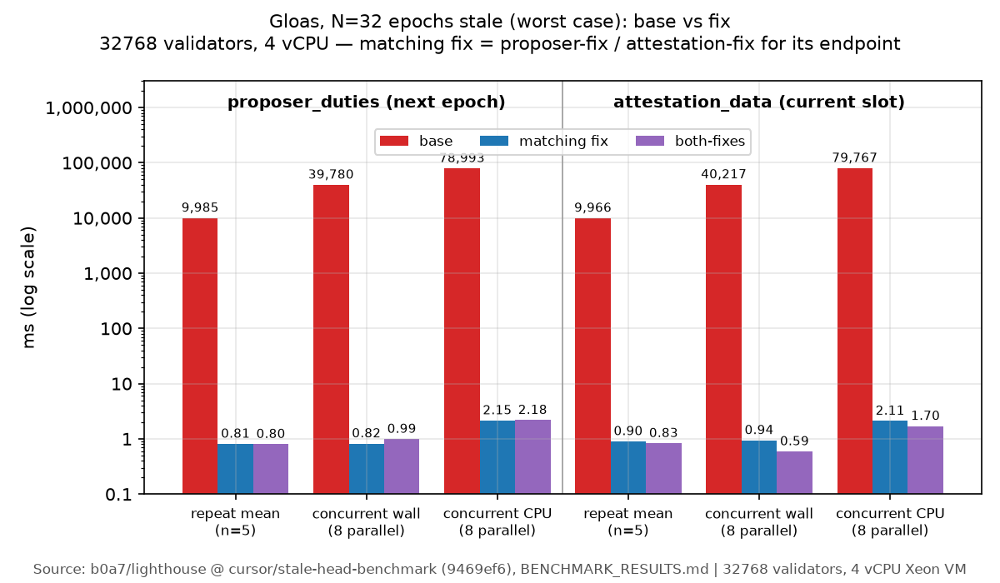
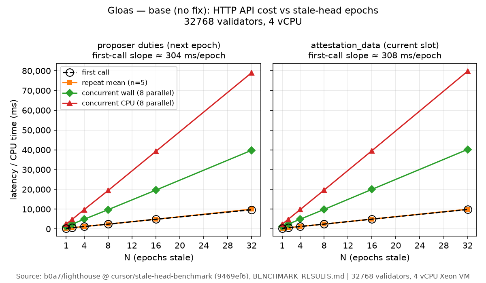
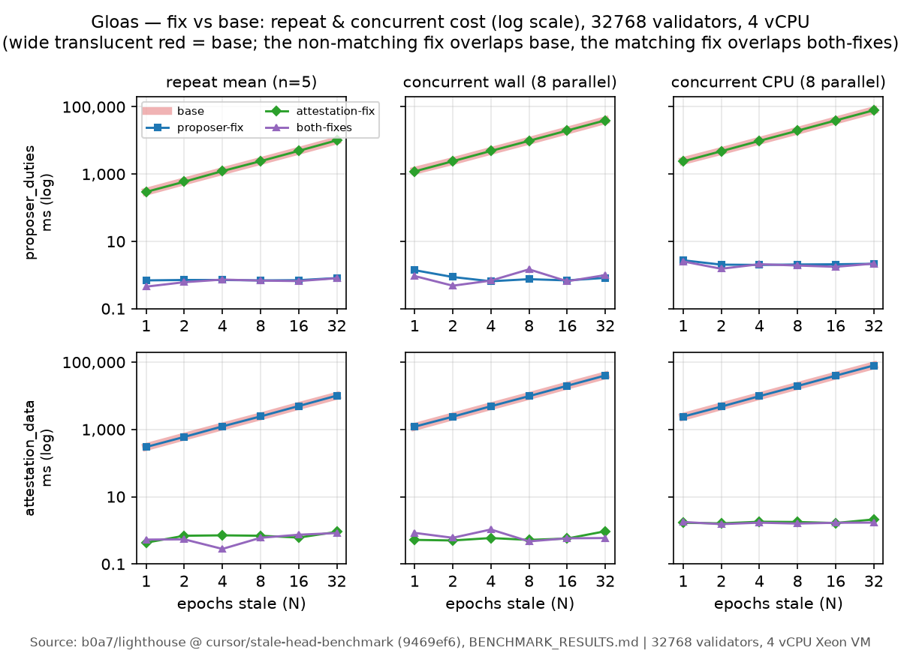

# Lighthouse stale-head HTTP API benchmark — graphs

Source: `b0a7/lighthouse` branch `cursor/stale-head-benchmark` @ `9469ef6`, `BENCHMARK_RESULTS.md`. 32768 validators, 4 vCPU Xeon VM. N = how many epochs the head is stale.

**Gloas, N=32 (worst case), log scale:** without a fix each repeat call costs about 10 s, 8 concurrent calls take about 40 s wall-clock and 79 s of CPU. With the fix, every one of these is about 1–2 ms.

**Gloas, base:** first, repeat, and concurrent cost all grow linearly with N, at about 300 ms per stale epoch per call. 8 concurrent calls take about 4× the single-call time in wall-clock and about 8× in CPU.

**Fulu, base:** the same linear scaling at about 37 ms per stale epoch, roughly 8× cheaper than Gloas.

**Gloas, all four variants, log scale:** with the endpoint's matching fix, repeat and concurrent cost stay flat below 3 ms at every N. Without it, cost follows the base line.

**Fulu, all four variants, log scale:** the same pattern. The matching fix keeps repeat and concurrent cost under about 3 ms, while base and the non-matching fix grow linearly with N.
